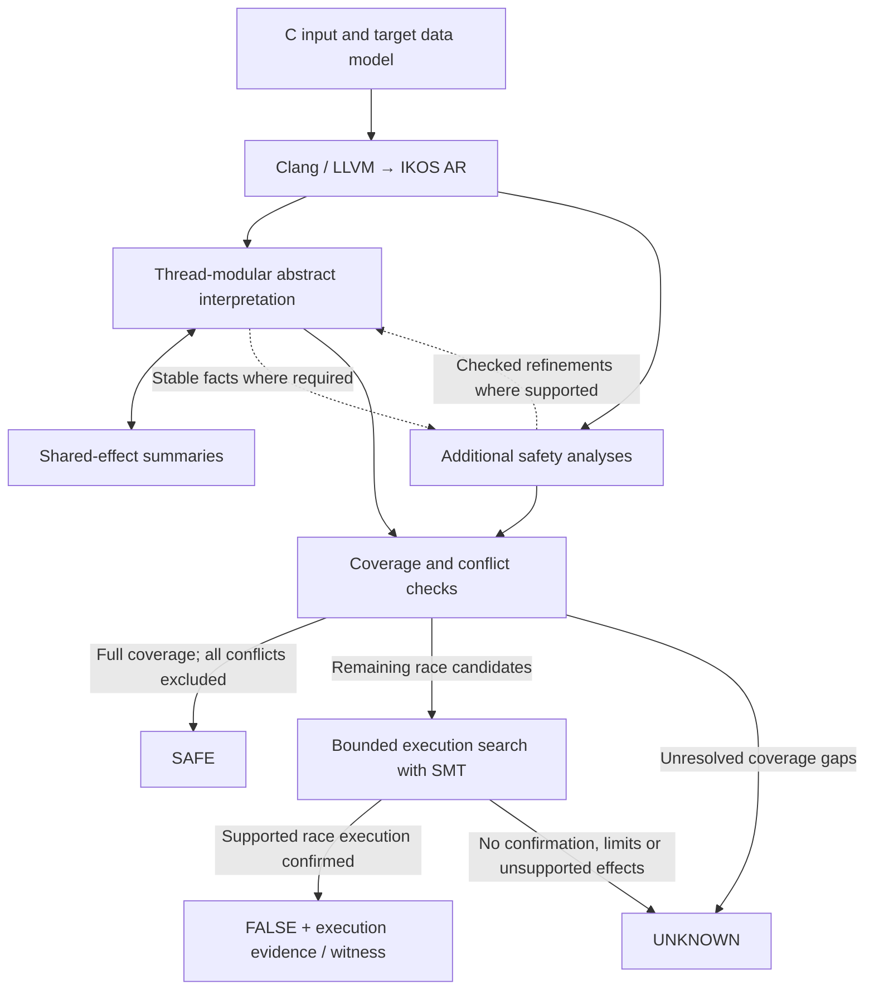

# Concurrent data-race analysis

IKOS-ConC checks concurrent C programs for data races. It uses abstract
interpretation to prove safety and bounded model checking (BMC) to confirm
remaining race candidates.

Start with the [installation and first example](../README.md#install-and-run).
This page covers running the tool, understanding results and finding the code.
The [technical reference](#technical-reference) keeps full contracts and regression
commands in expandable panels; you do not need to read them to run the tool.
For installation and failure diagnosis, see the [README](../README.md) and
[troubleshooting guide](../TROUBLESHOOTING.md).

## Analysis modes

Use the witness wrapper for the competition configuration. It enables abstract
analysis, Boolean partitions and bounded race confirmation together.

### Competition entry and source witnesses

In an unpacked archive:

```bash
./bin/svcomp_witness.py --data-model ILP32 --out witness.yml input.c
```

From a source checkout after installation:

```bash
./install/bin/svcomp_witness.py \
  --data-model ILP32 --out witness.yml input.c
```

The wrapper fixes the analysis to demote plus BMC and explicit Boolean
partitions (`--partitioning=guards`), accepts `.c`/`.i` inputs,
and emits a witness in SV-Witnesses format 2.2 for a confirmed race. It defaults
to ILP32; direct `ikos` defaults to LP64, so specify the model explicitly.
Use `--property FILE.prp` for a competition task. The supported property is:

```text
CHECK(init(main()), LTL(G ! data-race))
```

Other properties are rejected. The wrapper locates `ikos` next to itself unless
`--ikos` is specified. It prints a confirmed verdict only after writing the
witness. Output files are per invocation: the requested old witness is removed
before analysis, including unsuccessful runs. Parallel tasks need distinct
witness paths and analyzer databases.

For direct analyzer commands, abstract-analysis-only runs and partition options,
expand [Direct analyzer options](#direct-analyzer-options) below. These instructions
describe the current source checkout; an older archive may behave differently.
Check its `BUILD-INFO.json` before interpreting its results.

## Architecture and code navigation

The frontend translates C through LLVM into AR, IKOS's intermediate representation.
The abstract interpreter analyzes each thread using a shared summary of possible
cross-thread effects. Shared-summary changes trigger thread reanalysis.
Additional safety analyses check specific memory and
synchronization patterns. The race checker uses their results only when their
individual proof conditions hold.



**BMC confirms races; it does not prove unbounded safety.** Failure to find a
race, including bounded UNSAT, leaves the case inconclusive. The additional
safety analyses have separate contracts; they are not all numerical abstract domains.

For example, two accesses protected by the same proven mutex may be excluded
before BMC. Two unresolved accesses instead become search candidates; an
abstract warning alone cannot establish a real race.

| Component | Source |
| --- | --- |
| Concurrent worklist and shared-summary iteration | `analyzer/src/analysis/value/thread_modular.cpp` |
| Concurrent library transfers | `analyzer/include/ikos/analyzer/analysis/execution_engine/concurrent_semantics.hpp` |
| Shared environment and lock/thread facts | `core/include/ikos/core/domain/concurrent_global_env.hpp`, `lockset/lockset_domain.hpp` |
| Access records, conservative filters and dispatch | `analyzer/src/checker/data_race.cpp` |
| Bounded exploration, values, addresses, synchronization and evidence | `analyzer/include/ikos/analyzer/analysis/bmc/` |
| Independent exported AR execution checks | `scripts/validate_bmc_execution.py` |
| Source witness export and BenchExec interface | `svcomp_witness.py`, `benchexec/tools/ikos-conc.py` |

Original IKOS numerical analyses and general parameters are described in
[analyzer/README.md](../analyzer/README.md). Keep property queries separate from
reusable thread and memory semantics.

Range premises shared by the interpreter and safety analyses use
`analysis/all_access_facts.hpp`. Each analysis run collects observations for
the exact statement and object in its query inventory. All reachable contexts
must satisfy the predicate; a missing or failed observation cannot prove it.
The driver publishes the facts after replay and shared-summary flushing have
finished without further changes. A later observation invalidates publication.
Independent preflight facts still require the existing effect-coverage checks
before they can refine a fresh interpreter run. A range fact alone grants no
thread completion, synchronization, or permission to discard a shared write.

## Results and evidence

| Result | Meaning |
| --- | --- |
| **SAFE / TRUE** | Abstract coverage and conservative proofs exclude all conflicts under the supported contract. Missing accesses or incomplete effects cannot justify SAFE. |
| **Confirmed race / FALSE** | An encoded finite execution reaches conflicting accesses with the required values, objects, thread instances and synchronization. Direct `ikos` prints `definitely UNSAFE` in the recommended mode. |
| **Potential race / UNKNOWN** | The analysis is inconclusive: an abstract candidate, unsupported effect, bounded UNSAT, truncation or solver unknown proves neither safety nor a race. |
| **ERROR** | A nonzero exit, a terminating signal, or missing legal result output indicates execution failure. BenchExec handles external resource termination separately. |

A witness records the reported race for another tool to check. Keep three kinds
of evidence distinct:

| Check | What it checks |
| --- | --- |
| Witness format | The exported file follows its schema. |
| Offline AR execution check | The exported AR execution satisfies the checker's frontend and library assumptions. This is not automatic during a normal run. |
| Independent source-level validation | A separate validator checks the witness against the source program. Finding a different race does not validate this witness. |

Exporting format 2.2 or passing an AR check does not by itself establish official
competition witness acceptance. See [Validation and reproducibility](#validation-and-reproducibility)
for reports, offline checks and regression commands.

## Supported boundaries

The current target is concurrent C data-race analysis. Support depends on the
implemented operation and library contracts; it is not a blanket guarantee for
all C/POSIX programs.

| Area | Current scope and boundary |
| --- | --- |
| Input and layout | C via LLVM/Clang 14 and AR; explicit ILP32/LP64; competition wrapper accepts `.c`/`.i` |
| Memory model | BMC models its supported sequentially consistent executions; complete C11 weak-memory behavior is not implemented |
| Threads | Modeled pthread creation/join and finite dynamic instances; arbitrary creator trees and dynamic handle structures remain limited |
| Synchronization | Supported mutex/atomic/other library contracts; pthread attributes, failures, and ownership must satisfy their modeled premises |
| Objects | Global and supported stack/heap/pointer sources, byte ranges and access widths; general heap graphs, escape and lifetime remain limited |
| Unknown effects | Conservative coverage boundaries or explicit import/execution errors; omitted effects do not prove SAFE |
| Other properties | Original IKOS analyses remain available; deadlock/reachability are not claimed as complete concurrency properties |

Many additional safety proofs target **GNU/Linux ILP32** and restricted program
shapes. General ILP32/LP64 input support does not make every proof available on
both ABIs. Each panel below states its own requirements and refusal conditions.

| Mechanism family | What it contributes | Details |
| --- | --- | --- |
| Library effects and initialized fields | Conservatively model supported calls and recover field values; these facts alone do not prove ownership or synchronization. | [Values and library effects](#values-and-library-effects) |
| Private objects and indexed ownership | Exclude conflicts when both endpoints satisfy the required object, owner and lock relations. | [Memory and ownership](#memory-and-ownership) |
| Array slices and arena reservations | Prove that complete access byte ranges are disjoint. | [Memory and ownership](#memory-and-ownership) |
| Publication and initialization gates | Order initialization before certified later accesses; arbitrary later writes remain subject to checks. | [Synchronization and lifecycle](#synchronization-and-lifecycle) |
| Tokens, tickets and scalar protocols | Prove mutual exclusion or ordering under each complete protocol contract. | [Synchronization and lifecycle](#synchronization-and-lifecycle) |
| Serial child lifecycles | Exclude overlap only when the actual child and completion relation are established. | [Synchronization and lifecycle](#synchronization-and-lifecycle) |
| BMC instances, values and addresses | Build supported finite race executions with their actual effects and synchronization. | [Bounded executions](#bounded-executions) |

## Resource limits

| Limit | Default | Where it applies |
| --- | --- | --- |
| Local benchmark wall timeout | 30 s per task | The local benchmark script; independent of internal search limits. |
| BMC cooperative deadline | 20,000 ms | Confirmation search after abstract analysis; `--bmc-deadline-ms`. |
| SMT timeout | 1,000 ms per query direction | `--bmc-solver-timeout-ms`; positive values only. |
| Structural and proof limits | Mechanism-specific | Path, event, loop, state and other bounds; separate from time limits. |

These are engineering defaults, **not competition requirements**. Use the actual
BenchExec CPU, memory, core and task configuration for competition acceptance.
A zero BMC deadline disables confirmation; exhaustion cannot establish safety.
The cooperative deadline is not a hard timeout for the whole tool invocation.
Expand [Budget behavior and diagnostics](#budget-behavior-and-diagnostics) for details.

## Technical reference

Each panel retains the full implementation scope, conditions that refuse a proof,
and the available code or regression pointers. A certificate here means a checked
fact that may justify a particular refinement or conflict exclusion; it is not
a proof of the whole tool's soundness. Unsupported cases retain conservative
behavior or an explicit coverage boundary.

### Analyzer options and validation

<a id="direct-analyzer-options"></a>
<details>
<summary>Direct analyzer options</summary>

All commands below use the installed frontend, not a binary in the build tree.
Select `-m 32` for ILP32 or `-m 64` for LP64 to match the input's target.
The analyzer verdict behavior here describes the current source checkout.
Older archives may label standalone abstract candidates as definite races;
use their confirmation wrapper and check `BUILD-INFO.json` for the version.

### Abstract safety analysis

```bash
env -u IKOS_BMC_RECOVER ./install/bin/ikos \
  --analyses=race --concurrency=auto --demote-race-to-unknown \
  -m 64 -o output.db input.c
```

The abstract interpreter tries to prove safety. Unresolved race candidates and
coverage gaps remain inconclusive. It does not construct a concrete race.

### Abstract analysis with bounded confirmation

```bash
IKOS_BMC_RECOVER=1 ./install/bin/ikos \
  --analyses=race --concurrency=auto --demote-race-to-unknown \
  -m 64 -o output.db input.c
```

This is the recommended analyzer mode. The abstract interpreter first excludes
conflicts where its conservative proofs apply; BMC searches remaining candidates
for actual finite executions. The environment variable is enabled by presence:
`IKOS_BMC_RECOVER=0` still enables it. Remove it to disable confirmation.
The demote option is also required to enter the current confirmation path.
An abstract warning from another mode is not evidence of an actual race.
Without confirmation, unresolved candidates are reported as warnings rather
than definite races. This applies to the ordinary non-demote mode as well.

### Explicit Boolean partitions

Add `--partitioning=guards` to keep Boolean alternatives separate through scalar
copies, integer conversions, bitcasts, and helper parameters. A guard helper's
actual normal-return paths can then retain index bounds lost by interval joins.
The policy selects partition keys; it adds no assumptions and does not recognize
helpers by name. Redefinition and non-injective conversion use the underlying
machine-integer transfers and conservative partition merging.

Ordinary `ikos` still defaults to `--partitioning=no`. The existing `manual` and
`return` strategies retain their previous behavior. In `guards` mode one
partition key is managed automatically; this is not a relational integer domain.
For example, when a helper receives the integer index and computes its condition
internally, bounds on that formal do not necessarily refine the caller's copy.
Unsupported cases remain inconclusive. The initial end-to-end ownership tests
use ILP32, including programs with 64-bit data.

</details>

<a id="budget-behavior-and-diagnostics"></a>
<details>
<summary>Budget behavior and diagnostics</summary>

The local benchmark script defaults to 30 seconds of **wall time** per task.
BMC defaults to a 20-second cooperative search deadline and a 1-second SMT
timeout per race-query direction. The `ikos` and `ikos-analyzer` options
`--bmc-deadline-ms` and `--bmc-solver-timeout-ms` override these independently.
For example, `--bmc-deadline-ms=20000 --bmc-solver-timeout-ms=2000` changes only
those time limits. A zero deadline disables confirmation searches; unresolved
candidates remain UNKNOWN. The solver timeout must be positive: zero must not
silently request unlimited Z3 solving.

The competition wrapper `svcomp_witness.py` accepts these same two options and
forwards explicit values to IKOS. Omitting them preserves the analyzer defaults.

The deadline starts after abstract analysis and is checked cooperatively, so it
does not hard-limit the whole invocation. The legacy search checks the deadline
before each path-pair query; auxiliary completion queries also cap their solver
timeout by the remaining deadline. Path/event/loop bounds and initial candidate/
query tokens remain separate, unchanged limits. Some legacy retry passes reset
those tokens without resetting the deadline. Increasing the benchmark script's
wall timeout does not change any of these internal limits.

The effective time limits are saved in the analysis database. With
`IKOS_BMC_DIAGNOSTICS=1`, reports also record budget settings and observed
`search_deadline`, `candidate_budget`, `query_budget`, and `smt_timeout` reasons.
Several causes can coexist; exhaustion never establishes unbounded safety.

These are engineering defaults, not competition requirements. Competition
acceptance must use the actual BenchExec CPU, memory, core, and task configuration.
Record both the resource configuration and tool identity when comparing results.

Ordinary and auxiliary BMC queries pass the same file-level deadline to path
enumeration and encoding. Exhaustion remains inconclusive, and each solver
direction receives a timeout bounded by the remaining budget. This is cooperative cancellation;
abstract interpretation, indivisible internal steps and frontend work are not
a hard wall-time guarantee. The outer runner timeout remains separate.

</details>

<a id="validation-and-reproducibility"></a>
<details>
<summary>Validation and reproducibility</summary>

To save analyzer details, add `--format=json --report-file=report.json` to an
`ikos` command. The report contains per-check information and structured BMC
outcomes. `IKOS_BMC_DIAGNOSTICS=1` enables more detailed candidate diagnostics;
these may be large. A group may have several unsuccessful search reasons.

Confirmed executions can be checked offline by
`scripts/validate_bmc_execution.py`. This interprets exported AR executions under
explicit frontend and library assumptions. A normal run does not automatically
receive that acceptance. Witness format validity, AR acceptance, and acceptance
by an independent source-level validator must be reported separately.
An independent tool finding another race does not validate this tool's witness.

The original soundness regression cases and their controls are in
[review-repros](../docs/review-repros/). For an installed source checkout:

```bash
python3 docs/review-repros/bmc-2026-10-08/run.py --bits 32
python3 docs/review-repros/bmc-2026-10-08/run.py --bits 64
```

For a fixed external benchmark checkout:

```bash
IKOS_BMC_RECOVER=1 python3 svcomp_race_test.py /path/to/sv-benchmarks \
  --ikos "$PWD/install/bin/ikos" --demote --partitioning guards --jobs 4 --timeout 30
```

This measures the analyzer under a local wall limit, not the entire competition
wrapper or official CPU budget. Record source revision, binary/frontend hashes,
input revision, ABI, flags, environment, resource limits, and validator version.
Finite zero FP/FN observations do not prove soundness for all programs.

The optional `--inline-allocators` setting is available in `ikos`, the benchmark
runner, and the competition wrapper. It expands direct calls to bounded,
straight-line allocation constructors, giving each expanded call its own LLVM
allocation site. The checked subset has a fixed positive allocation size,
non-overlapping field initialization, and an initialization store that preserves
every integer argument. It leaves ordinary helpers and source-definedness checks
in place. It is disabled by default and cannot be combined with `--inline-all`.
This frontend transformation does not itself prove freshness, non-nullness,
thread completion, or race freedom; subsequent analyses retain those duties.

For the benchmark runner and competition wrapper, `--try-inline-allocators`
instead keeps the original conclusive result and retries only a valid UNKNOWN.
It first requests a read-only frontend inventory and skips the retry when no
eligible direct constructor call exists. The inventory reuses the inlining
predicate, does not change the LLVM module, and grants no safety or race proof.
Missing or malformed inventory for UNKNOWN is an execution error.
The second analysis uses its own report and must pass the same checks. Missing
reports, crashes, and inconsistent verdicts remain errors. This mode avoids
replacing existing proofs when a different LLVM representation loses precision.
The runner records both attempts. Its wall timeout and BMC limits apply to each
attempt (at most two); an external BenchExec CPU limit still covers the whole
tool invocation. Both refinement and forced inlining are disabled by default.

The BMC also supports a narrow GNU/Linux ILP32 semaphore prefix. It reuses the
closed library-effect proof, requires a real initialization with a constant
permit count from zero through the GNU semaphore maximum,
and retains actual main-thread posts before starting the selected workers.
Every worker wait before the two ordinary targets must fit those existing
credits; worker posts before the targets, used API results, atomic targets and
interleaved main/completion traces remain unsupported. Replay executes the
semaphore calls, checks opaque storage and joins all preceding providers'
clocks on acquisition. This does not add a safety rule or a general semaphore
model; unsupported cases remain inconclusive.
Only initialization with one permit supplies a token to the separate SAFE
ownership proof. General library-effect coverage does not grant mutual exclusion.

Explicit mutex initialization in a selected BMC execution must occur in the
main prefix before thread creation. Reinitializing overlapping live storage,
including after an unlock, remains unsupported; an empty owner set does not
end a mutex lifetime. Distinct, disjoint mutex fields keep separate lifetimes.

For FM-Tools registration changes, use the official checks through
`svcomp/check-fm-entry.py --fm-tools /path/to/fm-tools`. It checks LF, formatting,
sorting, and 2027 registration rules. Verify uploaded bytes and archive behavior
separately; a local pass is not an official CI or witness acceptance.

</details>

<a id="partition-inclusion-and-convergence"></a>
<details>
<summary>Partition inclusion and convergence — check coverage when abstract states merge</summary>

Partitioned value domains preserve a union of correlated states. Inclusion and
fixpoint convergence must compare with each actual right-hand partition, including
uncovered key ranges; comparing only convex hulls can incorrectly prove safety.
`core/domain/memory/partitioning.hpp` performs this check without initializing
undefined keys. Its regression suite covers distinct partition keys, gaps, signed
and unsigned one-bit/64-bit boundaries, and finite concrete-state inclusion:

```bash
cmake --build build --target test-core-domain-memory-partitioning
ctest --test-dir build -R '^core-domain-memory-partitioning$' --output-on-failure
```

The existing `--partitioning=manual` and `--partitioning=return` modes are optional;
this inclusion fix does not automatically enable partitioning or add assumptions.

</details>

### Values and library effects

<a id="heap-pointer-field-initialization"></a>
<details>
<summary>Heap pointer-field initialization — recover field values from all possible writes</summary>

The abstract interpreter can restore an initialized heap pointer field in a
worker when a full pointer store precedes every invocation of that worker.
This requires one concrete allocation, an exact byte offset, a direct main
initializer and closed, same-block create ordering. The restored value joins
all pointer writes, including later writes; it is not the initializer's value
alone. Ambiguous destinations, overlapping byte writes and uncovered effects
revoke the refinement and trigger reanalysis. This subset checks a closed set
of call effects: general memory-copy, vararg and opaque output operations fall
back to the ordinary conservative analysis. It does not prove general list
ownership or require pointer fields to remain immutable.

A second initialization certificate covers repeated calls to a constructor:
a single straight-line body allocates one constant-size object, initializes an
exact pointer field to NULL, and returns the base without exposing it earlier.
The interpreter can then constrain field loads using the union of all typed
writes to every possible source, including the initial NULL. Every source must
have the certificate and an available summary. This also works for allocation
sites that summarize multiple objects; it grants no unique object or lock
identity. Integer payload conversions are supported. Branching constructors,
interior returns, pointer export, unknown calls, byte overlap and missing source
coverage fall back conservatively. Lifetime checks remain separate.

Field coverage can also follow a closed initialization prefix in a larger
function: each malloc result reaches full-field initialization in the same
basic block before any read or escape. A direct, checked helper may initialize
the object through one pointer parameter and scalar payload parameters.
A main-global store/reload relay additionally requires an exact local source,
no return to the allocation block, and initialization before every possible
create. The complete field value still includes all sources and later writes;
byte overlap, uncovered effects and unsupported lifetime operations disable the
refinement. This certificate only refines field values: it grants neither
ownership nor exclusion of initializer-versus-published-access race pairs.

</details>

<a id="native-thread-handle-arrays"></a>
<details>
<summary>Native thread-handle arrays — model private handle storage without inferring completion</summary>

For closed Linux GNU ILP32 programs, the abstract interpreter also supports
repeated creates into private, fixed-size main-stack arrays of native 32-bit
`pthread_t` values. It checks the original LLVM and imported AR declarations,
every producer and array use, and independently proves the full output/load
ranges before exporting create-effect certificates into a fresh analysis.
Handle outputs and reads are unknown initialized native values, rather than
creation-site numbers. Joins through these values add no completion or
happens-before facts: neither joining one array element nor overwriting and
joining a handle proves that all instances of a worker have ended.
Escapes, representation inspection, uncovered calls and unproved ranges retain
the conservative coverage boundary. This subset requires NULL attributes,
worker arguments and join-result outputs, and unused API return values.
It does not establish list ownership, initialization or first-publication safety.

</details>

<a id="pthread-keys-and-destructor-effects"></a>
<details>
<summary>Pthread keys and destructor effects — account for thread-local library effects</summary>

The interprocedural interpreter has conservative POSIX pthread-key effect
summaries for Linux GNU ILP32 programs entered at `main`, with no entry-specific
omissions of global initialization or global constructors/destructors. The
original LLVM declaration, call ABI and imported AR callee must agree.
`pthread_key_create` with a NULL destructor
havocs its output and returns an unknown status; `pthread_setspecific` returns an
unknown status, and `pthread_getspecific` returns an unknown pointer including
NULL. Allocation failures are included. Association does not dereference the
stored pointer or publish it to another thread. Actual publication through a
retrieved value retains ordinary escape handling. These summaries confer no
ownership, lock or happens-before facts and do not prove get/set value equality.

Key-output writes still invalidate numeric, pointer and mutex summaries and
participate in race checking. A standalone global key avoids pointer-exposure
havoc only when its complete address/value use graph stays within the verified
key APIs and the runtime destination matches that exact object and offset.
Constant integer pointer tokens avoid the unsupported-address gate only when
every use is a bitcast or the value argument of verified `pthread_setspecific`.
Dereferencing, storing or passing such a token elsewhere retains the gate;
retrieved pointers remain unknown. A separate effect certificate accepts a
non-NULL destructor only when DataRace is the sole requested analysis. Its
actual defined `void(void*)` body and every direct helper are scanned in LLVM
and AR without argument-based pruning. Loads, stores, allocation, synchronization,
unknown/indirect calls and hidden ABI effects refuse the certificate. Pure
computation and control, verified nondeterminism, real abort and constant
assertion diagnostics may remain; aborting or diverging is not treated as
successful completion. The checker records this memory projection separately.
Mixed analyses keep the old callback fallback, and BMC/execution validation
still cannot omit TLS registration or callback executions. This proves no
callback assertion, successful key operation or TLS value identity. The older
source-only output/selector predicates remain NULL-destructor-only. Other
destructors, key deletion, incompatible APIs and intraprocedural pointer
analysis retain conservative coverage boundaries.
See POSIX.1-2024
[key creation](https://pubs.opengroup.org/onlinepubs/9799919799/functions/pthread_key_create.html)
and [thread-specific values](https://pubs.opengroup.org/onlinepubs/9799919799/functions/pthread_getspecific.html).

</details>

<a id="calloc-size-overflow"></a>
<details>
<summary>Calloc size overflow — retain allocation-failure continuations</summary>

`calloc` size overflow preserves the caller's normal failure continuation.
The interpreter multiplies interval bounds of the converted `size_t` arguments
using mathematical integers. Certain overflow returns NULL before allocation,
zeroing or lifetime updates. Possible overflow retains a NULL branch with the
complete preallocation state and joins it with the existing representable-size
transfer, including MUST facts. It cannot silently remove later shared accesses
by treating library allocation failure as arithmetic undefined behavior.
Caller arithmetic such as `calloc(n * 2, 4)` is evaluated before this check;
unsigned wrapping there is distinct from the API's internal size multiplication.
This correction covers overflow paths. It does not establish a general heap
generation or complete resource-failure model for repeated allocation sites.

</details>

<a id="zero-element-artificial-initialization"></a>
<details>
<summary>Zero-element artificial initialization — avoid inserting a seed into an empty array</summary>

The frontend's integer-allocation freeze pass preserves the first-cell nondet
seed for positive constant counts. A zero constant count has no seed. A dynamic
count branches on `count != 0` in the original LLVM count width; only that edge
contains the adjacent, tagged nondet call and Store. Both edges continue with the
original suffix. The pass adds no assumption, abort or zero-length-path pruning.
Existing scalar seeds and positive first-cell coverage are retained. Moving a
suffix during CFG splitting can prevent promotion of a later scalar allocation;
the seed still remains. Array-memory
read correlation remains the responsibility of the numerical memory domain.

This correction proves neither allocation success nor pointer validity or byte
extent. In particular, a raw wide LLVM allocation count can still exceed the
ILP32 importer's count width; this change does not repair that separate boundary.
It also does not certify stdio effects or general VLA safety.

`pass-freeze-uninit` checks both the isolated pass and basic pipeline, including
zero, dynamic, high-bit and wide counts, multiple allocations, loops and PHIs.
`python3 scripts/test_freeze_array.py` checks ILP32 scalar/array values and
continuations with 32-bit and long-long payloads and BMC disabled.

</details>

<a id="formatted-input-coverage"></a>
<details>
<summary>Formatted-input coverage — keep warnings for unmodeled parser effects</summary>

Formatted input can update observable parser state such as `errno` as well as
conversion destinations. Forgetting only pointer arguments can leave a cached
`__errno_location()` pointer at its old value and incorrectly discard an error
branch containing a race. Until a complete applicable summary covers these
effects, mapped `scanf`, `fscanf` and `sscanf` retain an uncovered-effect warning,
including calls whose conversion outputs are private. Raw extern calls keep
their existing conservative handling. This coverage gate asserts neither a
conversion result nor a particular errno value.

`python3 scripts/test_scanf_errno.py` covers raw and mapped APIs, cached-error
branches, unconditional conflicts and a no-input impossible-branch control,
with both int and long-long payloads under ILP32.

</details>

<a id="exact-scalar-string-input"></a>
<details>
<summary>Exact scalar string input — model a restricted sscanf call</summary>

The thread-modular analyzer supports a narrow source/AR-verified string-input
summary: actual declared `sscanf` or `__isoc99_sscanf`, GNU/Linux i386 ABI, an
immutable literal `%d`, and one complete signed 32-bit global or scalar-local
output object. Both raw extern and mapped libc routes use the same descriptor.
The input remains a possibly unbounded Read; the output is a four-byte possible
Write. The immutable format is separately verified. Return and output values
are TOP, including failed conversion leaving an old or uninitialized output.
Every call also forgets the existing errno memory object, so cached errno
pointers cannot retain a stale value. No parsing success or value range is inferred.

Errno accessor addresses must stay in same-function, whole-int load/store uses.
Escaping those addresses or exposing foreign runtime data refuses this summary
and retains explicit coverage even with a private output. Other unsupported
formats use the formatted-input gate above. Locale and unknown-call coverage
remain in force. This summary does not establish stream isolation or remove
`fprintf` effects, and is not added as a BMC or execution-checker leaf.

`python3 scripts/test_scalar_scan.py` checks raw/mapped calls, failure and cached
errno paths, private-output fallback, input/output conflicts, API/format/width
controls, shifted-input and partial-output overlaps, read-lock versus exclusive
mutex protection, and ILP32 long-long payloads. Implementation: `stdio_effects.hpp/.cpp`
in `analysis/execution_engine` and `src/analysis`, consumed by numerical transfer
and the data-race checker.

</details>

<a id="closed-runtime-stdio-frame"></a>
<details>
<summary>Closed runtime stdio frame — check when synthetic stdio effects can be omitted</summary>

An optional, immutable `RuntimeStdioFrame` is configured in each thread-modular
Context before numerical analysis. It inventories the actual reachable LLVM and
AR effects, entry options, source identities and GNU i386 ABI. Only a complete
frame supplies either of its two capabilities:

* A verified `fprintf(stderr, literal, ...)` with only promoted `%d` and `%%`
  conversions may omit its stream argument's synthetic application Write. All
  ordinary accesses and other argument effects remain.
* An exact startup scalar scan may suppress its own synthetic pointer escape
  only for the certified whole global output, checked again against the current
  singleton destination and zero offset. Pointer-write publication, integer and
  mutex invalidation, errno/output havoc and failure coverage remain unchanged.

The first subset admits whole integer storage, sealed serial argv input and
counted private i32 stack pools. Actual signed upper edges, stable counts,
zero/unit induction, native/AR byte strides, physical nonzero seed guards and
stack lifetime must match. Each pool's creation phase must cover every consumed
slot with a successful actual create; failure cannot reach a join. Its sole join
phase consumes each slot at most once. Native header and AR PHI-commit checks
reject repeated occurrences, irreducible cycles and restarted phases. These are
internal runtime-storage premises, not exported thread-success, handle-value,
completion or happens-before facts.

Unknown effects, pointer reconstruction/escape, FILE aliases or mutation,
unsupported formats, partial/foreign accesses, heap objects, missing range or
lifetime evidence refuse both capabilities. Existing warnings are never cleared.
The conditional seed extent uses the existing interprocedural Allocate normal-
continuation contract; this pass neither proves general pointer validity nor
changes allocation failure or zero-count continuations.

Implementation: `analysis/runtime_stdio_frame.hpp`,
`src/analysis/runtime_stdio_frame.cpp`, numerical transfer and the data-race
checker. `python3 scripts/test_runtime_stdio.py` covers refusal controls, real
neighboring races, renamed objects, raw/mapped scans, changed bounds, zero and
negative counts, repeated consumption and ILP32 long-long payloads.

</details>

<a id="fixed-heap-pthread-initialization-effects"></a>
<details>
<summary>Fixed heap pthread initialization effects — describe checked runtime-storage effects</summary>

A source-only `PthreadInitializationFrame` can seal constant byte effects for
`pthread_mutexattr_init`, recognized NORMAL/ERRORCHECK setters, and heap mutex
initialization before thread creation. The supported GNU i386/glibc route keeps
default private, nonrobust, PRIO_NONE attribute flags; successful valid
initialization is justified by this restricted runtime contract. Results remain
TOP in the numerical analysis. This is not a POSIX-general success assumption.

The frame checks the actual source/AR calls and memory operands, layout and
widths, every direct helper activation, immutable pointer relays, actual
allocation extents, preceding normal Store continuations, and all ordinary
accesses to runtime storage. It refuses repeated/overlapping initialization,
representation aliases, lifetime changes, unsupported CFG/effects and exhausted
budgets. A layout-only NULL-based offsetof expression may contribute an exact
LLVM-folded integer displacement; it cannot become an application address.

Both numerical transfer and the race checker consume the same immutable effect
description. Transfer checks the actual destination root and byte offset,
forgets only the described bytes and publishes interference; the checker keeps
initialization writes and attribute reads. Existing mutex acquisition/release,
NULL handling, MAY escape, thread completion and BMC remain separate. A wrong
ERRORCHECK unlock does not release another mutex. Ordinary data races remain
warnings even when initialization effects are fully covered.

The first subset admits single-block functions, bounded direct helper expansion,
constant main allocations, initialized runtime leaves before all creates and
private unread native create outputs. Unproved cases retain the old fallback.
Implementation: `analysis/pthread_initialization_frame.hpp` and its source;
regressions: `python3 scripts/test_heap_pthread_initialization.py` (ILP32,
including long-long payloads and invalidation controls). LP64 is deferred.

</details>

### Memory and ownership

<a id="private-worker-allocations"></a>
<details>
<summary>Private worker allocations — distinguish objects belonging to separate workers</summary>

The race checker can distinguish live allocations belonging to separate dynamic
worker instances even when points-to analysis merges their allocation sites.
The current certificate covers a single, non-repeated `calloc` in an actual
thread entry. It closes all uses of the allocation and, if used, its TLS pointer
slot. Pointer publication, an escaped slot address, unknown call effects, pointer
graphs, ordinary calls to the entry, and a reachable use after `free` prevent the
certificate. It never treats the static allocation site as a unique object.

Every certified access needs its full byte range within the successful
allocation. Constant offsets are checked mathematically. The supported dynamic
case uses the same defined count as [the calloc allocation](https://pubs.opengroup.org/onlinepubs/9799919799/functions/calloc.html), a zero-based loop counter, a sole
`+1` backedge and a strict signed comparison whose true edge dominates both the
access and increment. The induction proves non-negative indices and a
representable increment; LLVM `inbounds` and `nsw` are not proof premises.
Allocation failure does not grant non-nullness or prune the caller's path.

Only pairs whose two recorded accesses match certified LLVM/AR effects and exact
heap provenance are excluded. All existing access records, shared interference,
coverage checks and unrelated race candidates remain active. The calloc
certificate targets the ILP32 Linux/GNU ABI and does not establish general
creator-to-child or per-iteration ownership.

A separate certificate supports a positive constant-size `malloc` in `main`
whose result is passed to exactly one child. The allocation must dominate the
create, and every path between two create attempts must cross a new allocation
event. Pointer uses in the creator are limited to SSA bitcasts and that transfer;
all entry-function uses must identify the same actual create. Failed attempts
also consume the object, so retrying with an old pointer is rejected. No success
or worker-termination premise is added.

The child may use constant-offset integer fields inside the real allocation
extent and optionally free the original base. Exact mathematical offsets cover
the full access width; a use reachable after free invalidates the certificate.
Publication, parent accesses, array-stored aliases, extra creates, unknown
callbacks and joins needed to reclaim an object from the parent require further
proof and remain outside this subset. This rule preserves the existing NULL
failure branches, coverage and shared interference.

</details>

<a id="indexed-heap-ownership"></a>
<details>
<summary>Indexed heap ownership — relate heap owners to their protecting mutexes</summary>

A separate finite proof pass can relate a global array of heap roots to a
corresponding mutex array. It checks all supported writer transfers, including
helpers and loop joins, before supplying any exclusion certificate. Fresh malloc
instances acquire an immutable owner on publication; links must remain NULL or
within that owner. Copies preserve the relation, while conflicting joins forget
it. Allocation sites are not treated as unique runtime objects.

For a pair of heap accesses, overlap in the same live object implies equal
owners. If both accesses hold their owner's actual mutex, that pair cannot race.
This conditional proof does not establish pointer validity or narrow the original
value analysis. Both complete points-to sets must contain only known heap
locations; numeric addresses, TOP and mixed storage classes retain their original
candidates. Missing ownership on either endpoint also retains the candidate.

The initial subset supports ILP32 GNU/Linux fixed root/mutex arrays, one
self-referential pointer field per object, exact object extents and verified
pthread/malloc APIs. Root slots become immutable before worker creation.
Cross-owner links, unknown effects, unsupported escaping, free/realloc, partial
pointer writes or unproved address bounds disable the family certificate.
Coverage warnings remain independent. Unsupported programs use the existing
analysis and may remain UNKNOWN.

A second complete pass can retain distinct root heads while allowing nodes
shared by several lists before thread creation. A fresh object stored in a root
slot becomes a head and cannot be stored in another slot or link. Old link
targets may be shared; they receive no unique-owner certificate. New worker
objects must be constructed under their corresponding actual mutex and may
only be published through a head or new object with the same owner. The pass
closes all pointer writes, helpers and allocation contexts; unknown publication,
free, partial writes or changing an old link concurrently disable this mode.

A one-hop link load carries a conditional owner: only if its actual object is
from a verified worker allocation family does that owner apply. Every birth of
that exact allocation/context family must qualify; a MAY-spawned state alone is
insufficient. The consumer checks every location in the intersection of both
complete pure-heap points-to sets. Old or mixed allocation families retain the
candidate. Transitive link traversal is deliberately unsupported. This mode
reports `indexed-head-publication-owner-v1`; its BMC-disabled positive, negative,
renamed and 64-bit payload controls run with
`python3 scripts/test_head_publication.py`.

For guarded indexes, `--partitioning=guards` can supply the required array and
mutex ranges. The pass accepts verified zero-argument `__VERIFIER_nondet_int`
declarations, including the C old-style declaration representation. It follows
ordinary definitions rather than granting their names special effects. A verified
`abort` terminates that path after checking earlier accesses; it does not make the
whole prefix unreachable. Other return paths remain part of the proof.


Constructor-field recovery can also use a separate conservative analysis to
certify the byte effects of indexed mutex calls. Every observed address must
select a complete mutex inside the actual array, with exact API and layout
checks. Only the resulting effect certificates enter a fresh analysis; memory,
thread summaries, coverage warnings and failed caches are not reused. Missing
or invalid observations retain the original conservative behavior. The first
subset requires private, unread thread-handle outputs and unused create results;
helper-derived indices and consumed handles may remain unsupported. This does
not assert mutex-call success or establish heap-object uniqueness. Controls run
with BMC disabled via `python3 scripts/test_mutex_array_effects.py`.

Root and mutex arrays may also be separate subobjects of the same global
structure, including fixed nested structures and reordered fields. Each retains
its typed field path and absolute byte extent. LLVM `inbounds` alone does not
bound a nested array: the independent analysis must observe every pointer-slot
load/store and mutex call within its own complete subarray. All contexts and
iterations must pass; missing observations disable recovery. The fresh analysis
checks each recovered load's actual address again. Ownership indexes are relative
to the selected subarray; held mutex keys keep their absolute allocation offsets.
The shared pointer board remains a MAY union, and ordinary write invalidation is
unchanged. Escaping addresses, overlapping writes, unsupported siblings, packed
or union containers, and ambiguous families retain conservative behavior.
Run `python3 scripts/test_nested_array_ownership.py` for these ILP32 controls,
including 64-bit payloads and wrapping index conversions.

Implementation: `analysis/region_ownership.hpp` and
`src/analysis/region_ownership.cpp`. The checker consumes certificates only after
the original value analysis has converged. With `--format=json`, add
`--status-filter=safe` to inspect `indexed-live-heap-owner-v1` proof rows; safe
rows are hidden by the default report filter. Local positive, negative and
transformed examples run with BMC disabled via
`python3 scripts/test_region_ownership.py`.

</details>

<a id="stable-flat-array-slices"></a>
<details>
<summary>Stable flat-array slices — prove that workers access disjoint byte ranges</summary>

`ArraySlices` can exclude a pair of heap accesses when complete native/AR
frames establish disjoint inductive ranges over the same stable global pointer.
The current ILP32 subset handles one signed i32 induction loop per worker and
per array constructor, with exact scalar helpers and pre-create initialization.
Each loop uses an arbitrary iteration satisfying its inductive lower bound;
the actual guard, stride, allocation extent and full access width must be
proved. The increment must preserve the invariant without wrapping. This is
an unbounded range proof, not bounded-search UNSAT.

Every supported main, constructor, helper and worker effect is checked. Global
updates after the first create, partial cell writes, unknown calls, pointer
fields, frees, extra cycles and module assembly refuse the certificate.
Heap reads remain fresh values; they never acquire read-from equalities.
All possible startup states and all ranges of both endpoints must satisfy the
disjointness query. Shared translation by the same actual stable base preserves
disjointness, including modulo pointer arithmetic; no allocation success,
nonnullness, pointer validity or thread completion is inferred. Accesses after
the loop receive no loop-body certificate. Unsupported frames and solver
limits retain the existing candidate.

Run `python3 scripts/test_array_slices.py` for renamed positive, overlap,
effect-frame and byte-width controls, including 64-bit payloads on ILP32.
Implementation: `checker/array_slices.hpp` and `src/checker/array_slices.cpp`.

</details>

<a id="serialized-arena-reservations"></a>
<details>
<summary>Serialized arena reservations — prove that successful reservations do not overlap</summary>

An independent symbolic mode handles a closed, immutable heap array initialized
before all worker creation. It interprets every normal startup prefix and proves
the allocation size equals the positive element count times its stride without
32-bit wrap. Under one real default-normal mutex, the shared counter starts at
zero and every successful transaction strictly increases it within that count.
A success at zero is a nonempty reservation; a transaction without a Store must
have a provably empty processing loop. Later workers see an arbitrary counter
in the inductive range, rather than the first worker's startup value.

For a supported natural loop, the checker proves the iterator invariant at
entry, checks an arbitrary iteration and its backedge, and checks every full
element access against the owning half-open slice. It does not enumerate array
sizes, workers or loop iterations. Native GEP and AR PointerShift base, index,
stride and widths must agree. Scalar snapshots are per execution; data values
and memory-free helper returns are overapproximated. Overflow flags are proof
obligations, never assumptions. Both candidate endpoints must refer exclusively
to the checked live-heap allocation. This conditional byte-conflict certificate
does not establish successful malloc, pointer validity, completion or fairness.
Missing effects, aliases, lifetime or loop evidence, incomplete SMT checks and
resource exhaustion retain the ordinary candidate. Static SMT limits are
separate from BMC budgets; the finite global-array mode below is unchanged.

The checker can prove disjoint byte ranges in a flat global integer array when
each access uses a fresh reservation from a sealed counter. The initial subset
uses a real, defined `__VERIFIER_atomic_*` function with exact `void(int*)` ABI;
its complete body is non-interleaved under the
[SV-COMP atomic-function convention](https://sv-comp.sosy-lab.org/2026/rules.php).
Only the reservation body is atomic, not later caller accesses.

A separate finite-state certificate starts from the counter's exact initializer
and interprets each reachable complete transaction. A success returns the old
positive counter and strictly advances it, reserving the half-open slice between
those values. A failure writes zero and leaves the counter unchanged. The proof
must reach this deterministic exhausted self-loop; a partial search, unsupported
operation, overflow or budget exhaustion yields no certificate. Consequently
arbitrarily many later calls cannot reuse a successful slice. Every intermediate
arithmetic operation is checked before later guards, without assuming LLVM
`nsw` or `inbounds`.

All counter writers and actual calls are closed. Each out-parameter call writes to one
activation-private integer stack slot, with no address escape, later writer or
repeated call in that activation. A successful-result guard must dominate each
certified access, and its full byte width must fit both the reserved slice and
the real array. Both endpoints of an excluded pair need these facts for the
same counter and array. A shared-load reuse of a published index, zero result,
counter reset, escaping arena address or unknown effect keeps the ordinary
candidate. Points-to, interference, access records, BMC and coverage are unchanged.
An additional mode supports an integer-returning allocator protected by one
concrete, completely zero-initialized default-normal glibc mutex. Its complete
address inventory allows only the actual lock/unlock APIs. A finite ownership
analysis checks all defined helpers: lock requires certainly unheld, unlock
requires certainly held, and a returning helper that touches this mutex has
net-zero ownership. Possible ownership states join by union; loops reach a
finite fixed point. Reinitialization, escaping addresses, unmatched unlocks,
nested acquisitions and ambiguous ownership refuse the certificate.

The counter transaction itself requires exactly one continuous acquisition and
release. An old-counter read before lock, a release/reacquire between capture
and update, or a counter reload after release is rejected. The interpreter
selects each return phi from its actual predecessor. Only a direct SSA result
with a dominating successful-result guard supplies a fresh ticket; shared
reloads, stale merges and unsupported spills retain candidates.

These subsets target ILP32 Linux/GNU. They do not order an unrelated runtime
initialization against later accesses; general initialization phases still
need separate proofs.

</details>

<a id="immutable-heap-array-reads"></a>
<details>
<summary>Immutable heap-array reads — retain values from completely initialized, stable cells</summary>

`ReadonlyHeapReads` provides a separate, conservative source certificate for
startup-initialized scalar arrays and a depth-two pointer table. It traverses
the reachable main, constructors, workers and scalar helpers in the actual
LLVM/AR program. Mandatory whole-cell stores establish initialized prefixes by
induction; every published table must finish construction before any create.
The table is a fresh main allocation, avoiding reuse of a scalar snapshot through
a retyped alias. Published roots, dimensions and heap cells remain immutable.

Each full-width scalar-array read uses an arbitrary function of its allocation
snapshot and exact byte offset, so repeated reads of the same cell retain guard
bounds. Different cells and row payloads remain unconstrained. Mutable scalar
globals begin arbitrary; a cell owned by one closed, nonrepeated main-created
worker may retain that instance's stores and reloads. Other mutable cells may
retain a snapshot only within one balanced harness atomic region, after every
possible writer has been checked to use that atomic contract. Region boundaries
forget shared cells while retaining already-read SSA values. Main's observations
after creation remain fresh; no worker state is imported into main.
These scalar caches apply only to the arbitrary-header route below; the older
canonical route keeps fresh mutable loads. Before cache-assisted path pruning,
the new route closes all potential stores and calls through its scalar helpers.
Unknown writes, aliased stores and opaque calls refuse it even in a branch that
the later path proof could discard.

The canonical induction route remains available. A separate worker route covers
one noncanonical natural loop by cutting its header edges and checking an
acyclic traversal from an arbitrary header state. That state retains immutable
startup sources, but forgets worker-prefix guards, mutable cells and scalar
live-ins. All bodies, exits, suffixes and scalar helpers are checked; loop-carried
pointers, unsupported storage, residual cycles and unbalanced atomic paths refuse
the frame. This is coverage by an inductive overapproximation, not finite
unrolling or a termination claim. The exact C/AR one-bit nondet-bool declaration
supplies an arbitrary bit to ordinary byte-array initialization.

Each consumed table and row access requires a
complete initialized source and a proved byte range; unknown effects, unsupported
aliases, partial writes, solver uncertainty or exhausted proof budgets refuse
the entire certificate.

The checker can explain only the exact certified read's synthetic handle warning
and exclude its false alias with an actual direct whole-scalar global write.
All other effects and pairs remain. No shared MAY board, numerical pointer value,
nullity, allocation success, lock, join or completion fact is changed. BMC retains
its original handle-representation gate. These are conditional nullable heap
source facts under the existing access model, not memory-safety validation.

Implementation: `checker/readonly_heap_reads.hpp` and
`src/checker/readonly_heap_reads.cpp`. Regression entry:
`python3 scripts/test_readonly_heap_reads.py`; it includes ILP32 long-long data,
incomplete construction, changed indices, publication and alias mutation controls,
and real races remaining after heap reads have been certified.
`python3 scripts/test_readonly_loop_snapshots.py` additionally covers arbitrary
loop headers, duplicate worker instances, extra writers, atomic boundaries,
prefix-only guards, exact bool ABI, long-long row data and real scalar conflicts
remaining after successful heap certification.

The immutable-read, bucket-membership and fixed heap initialization analyses
share the stateless
`analysis/source_call_binding.hpp` check for the actual LLVM/AR callee, C calling
convention, argument agreement and unsupported ABI attributes. Each analysis
keeps its own source inventory and effect/safety proof; a successful binding
alone grants no memory, synchronization or safety fact.

</details>

<a id="immutable-bucket-membership-with-protected-payloads"></a>
<details>
<summary>Immutable bucket membership with protected payloads — check graph membership and bucket locks</summary>

`BucketListOwnership` checks a closed startup-built graph of embedded two-pointer
heads and individually allocated nodes. It interprets the actual LLVM/AR CFG,
helper calls, machine-width indices and simultaneous PHIs. Successful dynamic
allocations have separate identities; a real full scalar Store at the exact
allocation base establishes only the existing normal-continuation premise.
Every pointer cell must then receive its own complete Store before use.
At first creation, exhaustive next/previous closure assigns each live node to
exactly one head. Concurrent link mutation, cross-bucket membership, unknown
calls, lifetime changes, incomplete cells and unproved byte bounds refuse the
whole certificate.

Worker payloads are TOP. Scalar comparisons and actual helper arguments preserve
TOP; a TOP condition explores both successors without adding a chosen value.
TOP still cannot determine an address, extent or owner. Branch-only nondeterministic
choices may likewise become TOP after a complete scalar-use closure check. Complete
state exploration covers every reaching access, including repeated graph states;
resource exhaustion is refusal, never a bounded safety argument. Main is checked
on all paths before workers are projected onto their immutable graph frame.
Only identical complete frames are shared; no main path condition or payload
sample restricts a worker. Link offsets are proved single-valued before projection. All concurrent
payload accesses must hold the exact mutex of their bucket. This narrow model
uses GNU/Linux i386 default-normal mutex initialization with NULL attributes
(the ordinary sealed-runtime route in
[glibc 2.39](https://github.com/bminor/glibc/blob/ef321e23c20eebc6d6fb4044425c00e6df27b05f/nptl/pthread_mutex_init.c)), with each
aligned 24-byte leaf initialized once before creation and no later mutation.
It does not assume arbitrary POSIX initialization succeeds.

Only exact fully covered source effects and all combinations of certified access
endpoints can discharge warnings. The four-byte private create output has its
own actual native ABI and alignment proof. A real pointer-to-integer observation
may only feed integer casts and the main return value; it never becomes a usable
numeric address. The shared representation inventory checks this complete use
closure for an unreferenced, argument-free `main`; a branch, store, call or
non-main return refuses. Native handle arrays retain their separate closed-use
checks. Numerical/MAY summaries and BMC's original representation gate
remain unchanged. This is a live-byte race certificate, not pointer-safety,
allocation-success, termination, thread-completion or official witness validation.

Closed extra normal mutexes can be treated as runtime stutters; they grant no
bucket ownership. Readonly assertion strings are accepted only through actual
validated terminal assertion calls. At CFG joins, standard source-SSA liveness
includes PHI operands on predecessor edges. Dead current-frame SSA can be
forgotten before exact-state deduplication; caller frames, path constraints,
memory, precise live pointers and held owner locks are retained. A helper's return
is captured before its completed SSA frame is cleared.

Fixed private native `pthread_t` arrays reuse the real abstract interpreter's
whole-plan range observations: every create output and handle Load must have an
existing true observation, accumulated by AND across contexts and iterations.
Dirty fixpoints and missing thread coverage refuse. The native transfers already
use TOP values and grant no join HB independently of this checker. After the
first possible creation freezes the graph, a finite suffix pass checks every
CFG edge and admits only these native operations and pure control computations.
It collects all possible callbacks and enclosing private-array ranges. Those
ranges prove only object disjointness, never one precise slot or thread identity.
Application writes, graph changes and unsupported suffix calls refuse even after
a join. Only a complete source proof can explain its exact synthetic-native-call
coverage warnings; it does not clear the shared environment's coverage markers.

A shared narrow address gate recognizes NULL-root, constant, 32-bit layout
projections with identical computed LLVM/AR offsets. This observes no application
object address and supplies no nonnull, lifetime or inbounds/UB premise. Real
address observations, dynamic offsets and integer-to-pointer casts keep their
previous conservative gates. The native-array route does not extend this
exception to a pointer returned as main's exit code.

Implementation: `checker/bucket_list_ownership.hpp` and
`src/checker/bucket_list_ownership.cpp`. Regression entry:
`python3 scripts/test_bucket_list_ownership.py`; ILP32 controls include long-long
payloads, a nonterminating traversal, wrong locks, cross-bucket links, incomplete
initialization, early creation, native lifecycle changes, byte corruption and
integer-address observations with application-memory effects.

</details>

### Synchronization and lifecycle

<a id="self-publication-one-write-repeated-reads"></a>
<details>
<summary>Self-publication: one write, repeated reads</summary>

A separate self-publication certificate handles a scalar which is both the
state and the published value. Under one closed default-normal mutex, every
normal critical-section exit must leave the final value: an initial entry
executes exactly one Store, while an already-final entry executes no Store.
Even a same-value later Store refuses this rule. Induction over mutex ownership
proves a unique dynamic write across arbitrarily many worker instances. A finite
per-instance phase proof then orders that write before each certified post-gate
read, including repeated reads. It does not order arbitrary later writes.

The initial subset requires a closed uniform-zero integer array and scalar
body arguments. The complete memory-free entry prefix and guard helpers produce
argument constraints; every feasible argument tuple is enumerated, with a final
UNSAT check proving exhaustion. A model or enumeration limit is inconclusive.
The actual body is explored to a finite fixed point for every tuple, with
parallel PHIs, captured loads, exact array byte bounds and checked arithmetic.
Unprotected state loads remain TOP; their values do not justify their own race
exclusion. Unknown effects, escaping addresses, missing normal-return coverage,
weakening the write invariant, solver unknown or incomplete traversal refuse the
certificate. The parent is limited to private scalar effects and checked native
creates; no thread-count bound, successful completion or join fact is inferred.

</details>

<a id="finite-sequentially-consistent-protocols"></a>
<details>
<summary>Finite sequentially consistent protocols — exhaust the supported protocol state space</summary>

The race checker can independently saturate a finite SC protocol state space.
Its initial subset closes two distinct, once-created worker roots, direct whole
1–64-bit integer scalar effects, and all LLVM/AR call and memory effects on
ILP32. Each protocol global has an exact constant initializer and only actual
system-scope sequentially consistent loads and literal stores. RMW, fences,
weak or mixed accesses, escaped addresses, heap/array effects and unknown calls
refuse this certificate. The parent cannot write globals; its private scalar
handle effects are checked, and ignoring its joins grants no completion fact.
Memory-free helper calls may return in the projection, even when a concrete
call aborts; this does not prove assertions, progress or successful termination.

For each pair of unique worker access events, the pass retains possible PCs,
dynamic load/parallel-PHI snapshots, atomic last values and release causal tags.
It explores all scheduler prefixes to a reachable-state fixed point, including
progress by one worker after the other returns. Release/acquire propagation,
not the SC total order itself, must order the two events. Alternative histories
remain distinct; their causal tags are never unioned into a purported MUST fact.
Protocol loops may be unbounded, while a repeated target instruction or worker
instance refuses this first certificate. Unsupported scalar values become TOP;
branch alternatives are retained. Exhausted graph/state/transition budgets
refuse the proof. No bounded UNSAT or lack of a found race establishes SAFE.

</details>

<a id="two-mutex-handover"></a>
<details>
<summary>Two-mutex handover — prove ordering through a checked lock history</summary>

The race checker can also certify a closed two-mutex handover. An access inside
a continuous `D` interval after acquiring `A` is ordered against an access that
still holds `A` acquired under `D` after releasing `D`. Whichever `D` interval
comes first establishes the order, directly or through `A`. The finite analysis
joins possible lock-history states and requires each endpoint's role in every
reaching state and helper context. Releasing/reacquiring a mutex resets the
corresponding history; returns do not release mutexes. Unmatched unlocks,
recursive acquisitions, unknown calls or proof exhaustion refuse the certificate.
The initial scope requires exactly two closed default-normal global mutexes on
Linux ILP32, direct scalar memory effects, direct helpers and native thread
creation with a private scalar output and NULL argument. It adds neither a join
completion fact nor a BMC synchronization shortcut.

</details>

<a id="closed-first-publication-ordering"></a>
<details>
<summary>Closed first-publication ordering — order initialization before acquired accesses</summary>

The race checker can independently certify a finite publication protocol for
heap records with one pointer link and scalar payload. A closed allocation
prefix binds initialization stores to the actual helper call frame and installs
an initialized-pointer fact only at completion. Every subsequent root/link
publication must store NULL or an initialized pointer under the same concrete
normal mutex; every link acquisition requires that mutex. Immutable startup
roots may be acquired without it only after all possible root writers have been
checked. Exact copies, all-valid control-flow joins and helper returns preserve
the initialization ordering after unlock. Indexed root storage additionally
requires complete, aligned byte ranges from every final abstract access fact;
independent mutex-array effect certificates grant no publication lock.

The resulting rule excludes only initialization/initialization or
initialization/acquired-access pairs on covered live heap objects. It proves
neither pointer validity nor allocation-site uniqueness, and does not exclude
ordinary post-publication data races. Unknown effects, representation changes,
missing sources, unmatched ABI/callback uses, partial graph accesses or an
unproved protocol path disable the rule. This is separate from the disabled
legacy `private_init` heuristic and from the indexed ownership proof.

The ordering uses program order, thread creation and the POSIX mutex release /
acquisition memory synchronization contract. The first implementation limits
normal mutex representation to the checked GNU x86 ILP32 ABI (24 complete zero
bytes, aligned storage and the actual typed pthread API). It is not a claim of
support for arbitrary weak-memory publication protocols or for LP64.

</details>

<a id="sealed-runtime-initialization-gates"></a>
<details>
<summary>Sealed runtime initialization gates — check one-time initialization before later accesses</summary>

A separate `OnceInitialization` certificate orders a full-width scalar runtime
initialization against accesses that must pass a concrete default-normal mutex
gate. The sealed i32 state starts at zero. Exact critical-prefix execution for
entry states zero and one proves that the former performs one initialization,
publishes state one, and unlocks; the latter only unlocks. All state and gate
uses are closed, so this is an inductive invariant for arbitrarily many gate
entries, rather than a bounded-thread safety argument. The syntactic default
branch of a lowered switch need not be reachable from this invariant.

A finite interprocedural phase pass starts every actual callback without a
post-gate fact. It joins possible phases by union, intersects post-gate facts
over all observations of an access, follows helper returns, and iterates CFG
loops. A helper used both before and after the gate receives no universal
post-gate certificate. An initializer source reached outside its designated
critical prefix invalidates the gate proof. Unreachable definitions are ignored
only after closing the executable root/callback graph and function-address uses.

Only initialization/post-gate pairs for the exact global and full byte interval
are excluded. Later/later races, including equal-value writes, remain subject to
ordinary checks. Resets, address escapes, partial writes, unsupported effects,
incomplete prefixes or proof exhaustion refuse certification. The implementation
uses the same checked GNU x86 ILP32 normal-mutex representation as native arena
reservations; 64-bit scalar payloads are supported on this ABI. It changes no
points-to, interference, coverage or BMC semantics.

Arena success guards also recognize a narrowly proved terminating zero branch
when raw CFG dominance retains a continuation after a defined helper. The guard
must dominate the selected access. Its zero-successor block must encounter an
actual libc `abort` call, or an actual `void(i32)` helper called with literal
zero whose exact scalar comparison/branch path reaches that abort. Only unused,
verified freeze metadata calls are transparent; an earlier ordinary call, an
unknown condition, a return, a loop or a bare `unreachable` refuses this extension.
This does not infer termination from a helper name or `noreturn` attribute, and
changes no LLVM CFG, numerical invariant, coverage or BMC result directly.

</details>

<a id="monotone-publication-through-a-mutex-protected-flag"></a>
<details>
<summary>Monotone publication through a mutex-protected flag — order earlier writes before observed reads</summary>

`GuardedPublication` proves a pair-specific ordering from main's scalar writes
to reads by any number of workers. A closed, non-TLS global flag starts at zero
and has one noncyclic constant-one Store in nonreentrant main. All its accesses
use the same actual default-normal GNU i386 mutex. Watched payload globals have
only full-width direct accesses; every writer is main, and no CFG path from the
publication Store reaches another payload write. Helpers cannot hide watched
accesses or mutex/condition operations. Calls, function addresses, foreign runtime
data and pointer representations are closed independently of numerical values.

A finite CFG worklist tracks possible held states (union), observed publication
(AND), and continuously protected flag-Load identities (intersection). Only an
exact Boolean guard edge implying one from a real protected Load establishes
observation. Other branches are both explored. Unlock and condition wait clear
cached Loads. Under the sealed zero-initialized 48-byte condition variable and
24-byte default-normal mutex contract, a normal cond-wait return retains mutex
ownership; spurious wakeups and failure statuses grant no observation. Robust,
priority-protect, custom initialization, cancellation, destruction and unknown
object uses are outside this contract. Source evidence is the [glibc 2.39
condition-wait implementation](https://github.com/bminor/glibc/blob/ef321e23c20eebc6d6fb4044425c00e6df27b05f/nptl/pthread_cond_wait.c).

Because only main can publish one, a worker observing one while owning that
mutex follows the publisher's actual release, transitively through intervening
owners. Earlier main writes therefore precede its later payload read, including
reads after unlock. This finite MUST proof covers loops and arbitrary worker
multiplicity; it does not enumerate bounded schedules or infer termination.
Only matching actual source/AR write/read endpoints consume it. Unsupported
aliases, effects, control origins and exhausted budgets grant no certificate.
Real API termination is checked by declaration and intrinsic identity; a
returning user-defined `abort` or bare `unreachable` cannot remove a predecessor.

The analysis leaves numerical/MAY state, public lock/HB/join facts and BMC
unchanged. It inherits the existing object-based pthread API effect envelope,
without proving arbitrary invalid-handle libc behavior. Run
`python3 scripts/test_guarded_publication.py` for ILP32 int/long-long payloads,
8/32-bit flags, loops, guard polarity, spurious-wakeup, late-write, alias and
termination controls. Implementation: `checker/guarded_publication.hpp` and
`src/checker/guarded_publication.cpp`.

</details>

<a id="closed-binary-atomic-tokens"></a>
<details>
<summary>Closed binary atomic tokens — prove exclusive access through checked atomic transitions</summary>

`BinaryTokenOwnership` can independently certify a global token initialized
at zero. Supported operations take an i32 pointer or use an exact direct global
with 8-, 32- or 64-bit integer storage and no arguments. Actual defined
`__VERIFIER_atomic_*` bodies must implement checked
zero-to-one acquisition and one-to-zero release. Exact execution at both entry
values includes their scalar guard helpers: the wrong entry must terminate via
actual libc abort, rather than return. Full-width token uses, function-address
uses, callback roots and external effects must be closed. The rule relies on the
SV-COMP complete named-atomic-body convention; it grants no mutex semantics to
an arbitrary function name or C11 relaxed flag.

A finite per-thread ownership pass starts every root unheld. MAY ownership joins
by union; acquisition requires certainly unheld and release certainly held.
Helpers return their actual possible ownership states, loops reach a fixed point,
and every source access intersects its held fact over all reachable contexts.
A root that returns while held leaves the token occupied; thread exit does not
release it. Unknown effects, foreign release, ambiguous ownership or incomplete
proofs refuse the affected certificate. Two exact direct-global accesses
that must own the same certified token can be excluded. A separate rule orders
an exact atomic transition's token store with a full-width ordinary token read
that must hold that same token: another thread cannot perform a successful
acquisition or release during this ownership interval. Transition bodies are
not marked held, and unheld observations or ordinary token writes receive no
exemption. Volatile storage supplies no synchronization; the proof still needs
the actual atomic body and ownership. Integer extension/truncation inside the
transition is evaluated at both entry values, including byte-stored Boolean
guards. This neither makes caller
statements atomic nor exempts unprotected accesses before or after the interval.

Finite arena reservations can consume actual events from this completed token
certificate. They still require exactly one acquisition and release around every
counter read, capture and update, and the original complete finite counter
closure and byte-range proof. A balanced release/reacquire protocol is therefore
insufficient for a reservation. These events retain their token identity and are
not represented as native pthread mutexes.

Sealed once-initialization gates can also consume these actual token events.
Their exact state-zero/state-one prefixes and MUST post-gate facts remain
independent obligations. Token gates consume the producer's complete actual
event set, including operations with no pointer argument; the gate still needs
one physical acquisition and a closed release set. A prefix may call a defined
void helper with one actual 32- or 64-bit integer constant. Native and AR actual
bits must match, and an initialization through its formal must store that exact
AR formal. A helper invocation before or after the initializing prefix cannot
reuse its prefix-only binding: the whole-program phase check still checks every
invocation. Volatile state or payload accesses keep these same obligations and
supply no synchronization. A narrow payload helper binding additionally accepts
actual defined `void(D*, D, D, i32*)` bodies: all calls must pass the same exact
32- or 64-bit global as D and a closed caller-private i32 output slot. Every
pointer use, full-width source/AR effect and complete helper body is checked.
The same physical call may repeat in a retry loop; the output is private, not
an immutable ticket. Post-gate facts intersect over all calling contexts,
including pre-gate invocations. This binding grants no atomicity and never
orders ordinary later/later conflicts. Ambiguous aliases, escaped outputs,
partial effects or another actual payload refuse the binding.

</details>

<a id="closed-gnu-binary-semaphores"></a>
<details>
<summary>Closed GNU binary semaphores — prove exclusion under a restricted runtime contract</summary>

A shared `PosixSemaphore` description covers an aligned, zero-initialized,
16-byte global `sem_t` in the GNU/Linux i386 profile. It requires one actual
`sem_init(&object, 0, 1)` in main's entry block before all helper/worker entry,
exact source/AR calls, and closed object uses through `sem_wait`/`sem_post` only.
Numerical transfer forgets the control bytes and publishes their interference;
results remain TOP. The checker omits only this sealed opaque control storage,
whose representation cannot be observed or changed by application accesses.

Normal return from untimed wait acquires a permit in the supported modern Linux
no-user-handler profile. This is supported by [glibc 2.39 sem_wait](https://github.com/bminor/glibc/blob/ef321e23c20eebc6d6fb4044425c00e6df27b05f/nptl/sem_wait.c),
its [slow path](https://github.com/bminor/glibc/blob/ef321e23c20eebc6d6fb4044425c00e6df27b05f/nptl/sem_waitcommon.c),
and the Linux v6.6 [untimed futex](https://github.com/torvalds/linux/blob/v6.6/kernel/futex/waitwake.c)
and [signal restart](https://github.com/torvalds/linux/blob/v6.6/arch/x86/kernel/signal.c)
paths. GNU ABI selection is a model selection, not a probe of the executing
kernel. Generic POSIX EINTR behavior is not assumed away: user handlers,
cancellation/setxid APIs, timed/try waits, foreign runtime data observations,
unknown calls and escaping callbacks refuse this profile.

`BinaryTokenOwnership` reuses its existing finite U/H CFG and helper fixed point:
wait requires U and yields H; post requires H and yields U; merges retain both
possibilities and each access must be held in every reaching context. Initial
capacity one and these balanced transitions establish mutual exclusion; an extra
post, omitted wait or mixed-held branch cannot establish the theorem. Returning
while held retains occupancy. Only pairs with both endpoints certified held are
excluded; semaphore events are not exported to arena or once analyses.

A separate malloc-derived handle array can be admitted to this token inventory
when pointers flow only through casts/GEPs, exact NULL-attribute create outputs,
whole handle loads used only by NULL-output joins, and base free. It retains the
existing object-based pthread effect envelope: heap outputs are havoced, unknown
handles grant no HB, and normal checker accesses remain. This does not establish
allocation bounds, nonwrap, nonnull, handle validity or join completion, and does
not certify concrete libc behavior for arbitrary invalid handles. Native handle
range certificates and their checks are unchanged.

Implementation: `analysis/posix_semaphore.hpp` and its source, numerical transfer,
and `src/checker/binary_token.cpp`. Run `python3 scripts/test_posix_semaphore.py`
for ILP32 int/long-long, branching, capacity, lifecycle, alias, TLS and API controls.

</details>

<a id="monotone-ticket-ownership"></a>
<details>
<summary>Monotone ticket ownership — track unique reserved and held access rights</summary>

`BinaryTokenOwnership` also checks a separate ticket certificate. It never exports
these permissions through the binary-token event interface used by arena or once
proofs. The current subset uses two zero-initialized unsigned 32-bit globals:
issued tickets `T` and the current service index `S`. A complete actual named-atomic
issuer must reject `T == UINT32_MAX`, write the previous `T` to a private scalar
outcell, then increment `T` once. The guard's actual scalar helper is interpreted
on input zero over its complete returning control flow; its name is irrelevant.
Native/AR addresses, widths, value origins and unsigned additions must match.

The inductive invariant is `0 <= S <= T <= UINT32_MAX`: issued rights have unique
numbers in `[0,T)`, and consumed rights are `[0,S)`. A private reserved right becomes
Held only through the real `ticket == S` exit of a closed atomic spin loop. Its
exit has no bypass predecessor. A release advances `S` exactly once inside a real
atomic section and consumes Held. Since a holder has `S = ticket < T`, its release
also cannot wrap. While that right remains Held, no different right can acquire
or release the same service number. Actual atomic serialization, rather than
volatile accesses or interleaving order alone, orders the protected accesses.

A finite MAY worklist tracks None/Reserved/Held through every branch, loop and
actual helper return. Endpoint observations intersect all main/thread/helper
contexts; normal root exits must have no live right. Repeated issuances require
a consumed previous right and a fresh actual outcell write. Arbitrarily many
successful thread creations and synchronous calls remain separate activations;
no thread count or ticket range is enumerated. Creation failure creates no right.
All ticket-cell/counter uses and native/AR memory/call effects are closed. Unknown
aliases, partial writes, stale snapshots, unmatched atomic scopes, extra writers,
signed or unsupported counter widths, recursion and limits refuse this proof.

Run `python3 scripts/test_ticket_ownership.py` for ILP32 scalar/wide-payload controls,
including early release, cross-context helpers, repeat issuance, missing atomic
sections, native API identities and overflow boundaries.
Implementation: `src/checker/binary_token.cpp`; these are pair-exclusion facts,
not BMC UNSAT, thread-completion, allocation-success or pointer-validity facts.

</details>

<a id="mutex-protected-scalar-protocols"></a>
<details>
<summary>Mutex-protected scalar protocols — explore protected values and synchronization histories</summary>

`ScProtocol` has a separate protected-mutex mode, with fresh inventory and state;
the existing System-SC atomic mode keeps its own rules. The current subset is
GNU/Linux i386, two distinct single-created roots, isolated global normal mutexes,
whole scalar accesses and a closed native/AR effect frame. An independent prepass
explores every root CFG branch without consulting guard values, intersects the
locks at **all** accesses to each cell, and checks balanced normal returns.
Only consistently protected cells with matching initializer bits and exclusively
literal stores become finite exact registers. Other shared reads remain TOP.
Helpers must be memory-, synchronization-, thread- and callback-effect free.

The finite kernel retains saved guard reads, actual mutex owners and causal tags
published by unlock and imported by the next lock. Ordinary value communication
or interleaving order supplies no happens-before edge. A pair is excluded only
after the complete reachable-state worklist contains no unordered target events;
limits or unsupported effects retain the candidate. Endpoint blocks are acyclic
and bound to actual root accesses and whole native/AR widths. This proof does not
use bounded BMC UNSAT, assertions about payload values or allocation assumptions.

The lifetime frame requires default NULL-attribute initialization before both
creates, both actual current-child joins before destruction, private unobserved
handle slots, no reinitialization or later sync uses, and only quiescent main
shared reads. Default initialization/normal synchronization and ordinary join
continuation model GNU glibc 2.39 behavior under the stated isolated-storage,
sole-joiner, no-detach/cancel premises; they are not arbitrary ignored-return
POSIX success guarantees. Create failure retains IKOS's existing no-child,
no-HB/output-only unknown-handle envelope, not a claim that invalid real glibc
handles are safe. Abort projections preserve preceding events and supply no
normal completion. No mutex success is inferred from a wrapper return value.

Run `python3 scripts/test_protected_protocol.py` for protocol, lifecycle,
ALL-access protection, source API and ILP32 wide-integer controls.
Implementation: `checker/sc_protocol.hpp` and `src/checker/sc_protocol.cpp`.

</details>

<a id="serial-dynamic-thread-lifecycles"></a>
<details>
<summary>Serial dynamic thread lifecycles — check when child activations cannot overlap</summary>

`ThreadLifecycle` preserves a finite relation between actual scalar control,
helper returns and an outstanding current child. Creation includes both an
existing joinable child and a failure with no child and unknown handle bits.
An owned handle can be reused only after its prior child was consumed; saved,
partial, escaped and foreign handle flows refuse certification. Each admitted
join consumes the actual immediate full-width slot load. Every non-NULL result
must be a private, live, unread pointer-sized local object; its value stays
unknown. The first subset uses global scalar native handle slots and a closed
acyclic spawn tree with at most one outstanding child per parent activation.

CFG and helper results join by a set of possible states. Loops run to a finite
fixed point; work exhaustion emits no proof. An absence fact intersects every
state and calling context of the actual access. Child exit summaries are checked
bottom-up at every real Return, so a parent's join can discharge descendants
only when its child always drains them. The same argument serializes repeated
activations without changing the ordinary thread-uniqueness or joined digests.
Payload reads stay unknown. Exact ordinary source/AR effects remain in the
checker; implicit call effects do not consume these temporal certificates.

The ignored-return completion rule models ordinary GNU/Linux i386 join as in
[glibc 2.39](https://sourceware.org/git/?p=glibc.git;a=blob_plain;f=nptl/pthread_join_common.c;hb=glibc-2.39):
an existing unconsumed joinable child, one parent joiner, no detach/cancel,
parent-held locks or waits outside the acyclic parent-to-child topology.
This is narrower than a portable POSIX guarantee for every ignored-return join.
A no-child join keeps IKOS's existing no-HB, output-only unknown-handle envelope;
it supplies no successful-join edge. That envelope is an explicit library model,
not a guarantee about real libc behavior for arbitrary invalid handles.
Default NULL-attribute mutex calls are confined to disjoint opaque global storage;
initialization/destruction require quiescent descendants. This proof supplies
no mutex-success or mutual-exclusion fact. Unknown effects, callbacks, aliasing,
incomplete normal exits or additional creators keep the candidate.

Run `python3 scripts/test_thread_lifecycle.py` for ILP32 serial-loop, transitive,
failure, stale-handle, helper-context and wide-payload controls.
Implementation: `checker/thread_lifecycle.hpp` and `src/checker/thread_lifecycle.cpp`.

</details>

### Bounded executions

AI and BMC have different coverage responsibilities. A fact sufficient to exclude
all conflicts is not necessarily a concrete value source for a BMC execution.

<a id="bmc-thread-instances-arguments-and-heap-handles"></a>
<details>
<summary>BMC thread instances, arguments and heap handles</summary>

For supported main/worker candidates, BMC can retain finite auxiliary child
executions through their actual returns before a successful join. Those children
contribute their reads, writes and synchronization to the same concrete execution;
a completion edge alone cannot replace their effects. The fallback requires
supported handle generations and rejects nested child creation/join, unsupported
handle storage and atomic targets whose completion suffixes it cannot retain.
The existing complete-path search for atomic targets remains available.

The inert-child fast path traces an integer join handle back to its actual load
and checks earlier uses of that slot. An unresolved handle or a previously
consumed slot cannot establish another successful join. The concrete AR checker
also tracks whether each created instance has been joined or detached. BMC can
model a successful detach of a still-joinable instance identified through private,
native-width main storage. Reusing the slot for a new create gives a new instance;
it does not make the old instance joinable again. Unresolved or escaped handles
remain unsupported.

BMC also supports a native-pointer-width integer passed through a thread's
`void*` argument and converted back to an integer. The value comes from the
definition executed before that particular create, including repeated loop
occurrences; signedness changes preserve the bit pattern. The concrete AR
checker treats this as a numeric pointer and grants no permission to dereference
it or perform pointer arithmetic. Object-pointer conversions and non-native
width round trips remain unsupported. This is a contract for the imported AR
and configured LLVM target, not a portable C pointer-representation guarantee.

BMC can search a single main allocation whose size depends on one genuine
integer nondeterministic source. After the established path search fails, it
tries source values 1 through 4, retaining the real loop guards and binding the
same value to the allocation extent in SMT. These are search samples, not a
restriction on the program's possible inputs or evidence of safety.
The supported heap handle storage remains private to main: native-width,
aligned create outputs must fit the allocation. A supported `free` consumes
that allocation's base exactly once; publication, integer address export,
unknown pointer derivation, interior or repeated free, and subsequent use
leave the execution unconfirmed. Actual intermediate inbounds pointer shifts
are checked as well. The AR checker independently checks allocation size,
create output identity/alignment, free identity and lifetime. Heap join loads
still require additional handle-source and generation support.

</details>

<a id="atomic-targets-and-communication"></a>
<details>
<summary>Atomic targets and communication — retain the required execution suffixes and ordering</summary>

When either selected access is inside a verifier atomic region, the exported
execution retains both target roots through completion. The independent AR
checker also requires both roots to finish, so an atomic-end marker alone
cannot hide a later assumption by truncating the trace.

Absence of pthread synchronization does not exclude communication between
verifier-atomic sections. BMC therefore retains its conservative adjacency
conditions for mixed atomic/plain targets. The AR checker also tests ordering
under a stronger relation that serializes complete atomic sections; a pair
ordered only by this additional relation is `UNSUPPORTED`, not certified as a
race. This is a conservative acceptance condition, not an implementation of the
complete CAT memory model. External calls inside an atomic section are limited
to supported nondeterministic inputs, assumptions, and `ffs`; ordinary helpers
must be expanded. Other library effects require further communication modeling.

</details>

<a id="exact-ffs-values-in-bmc"></a>
<details>
<summary>Exact ffs values in BMC — compute the lowest set bit of the actual argument</summary>

BMC models the POSIX `ffs(int)` library declaration with its exact 32-bit
argument: zero returns zero, otherwise the result is the 1-based index of the
least significant set bit. The independent AR checker computes that result
from the replayed argument. Definitions with the same name execute their
actual bodies; incompatible signatures and calling conventions are unsupported.

</details>

<a id="startup-heap-pointer-fields-in-bounded-executions"></a>
<details>
<summary>Startup heap pointer fields in bounded executions — bind loads to actual initialization stores</summary>

The BMC address resolver can follow a full-width object-pointer Store into a
fixed heap field before the first thread creation. It uses the last actual Store
occurrence, including a prior NULL initialization, and resolves its value in that
call's dynamic context. Every retained trace is then checked: a later overlapping
write, symbolic alias, partial write, or library output makes this route
unsupported. The rule does not model mutable pointer read-from or allocations in
worker threads, and keeps the existing activation, lifetime and atomic contracts.

A certified pointer Load exports its allocation instance, extent and byte offset.
The independent AR checker compares them with the pointer obtained from its own
byte-memory replay and also verifies the actual read-from source. This validates
the selected AR prefix, not a C-source witness. Run
`python3 scripts/test_initialized_pointer_fields.py` for ILP32 int/long-long
controls, alias/output corruption and damaged execution evidence.

</details>
