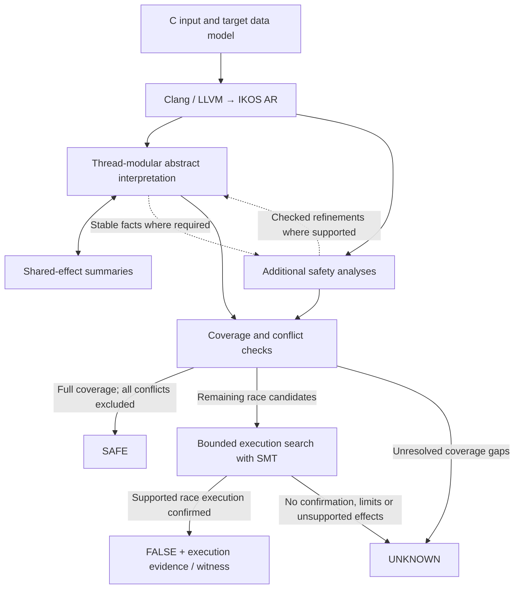

# Concurrent analysis architecture

[Concurrent analysis documentation](../../CONCURRENCY.md)

## Architecture and code navigation

The frontend translates C through LLVM into AR, IKOS's intermediate representation.
The abstract interpreter analyzes each thread using a shared summary of possible
cross-thread effects. Shared-summary changes trigger thread reanalysis.
Additional safety analyses check specific memory and
synchronization patterns. The race checker uses their results only when their
individual proof conditions hold.

**BMC confirms races; it does not prove unbounded safety.** Failure to find a
race, including bounded UNSAT, leaves the case inconclusive. The additional
safety analyses have separate contracts; they are not all numerical abstract domains.

For example, two accesses protected by the same proven mutex may be excluded
before BMC. Two unresolved accesses instead become search candidates; an
abstract warning alone cannot establish a real race.

| Component | Source |
| --- | --- |
| Concurrent worklist and shared-summary iteration | [analyzer/src/analysis/value/thread_modular.cpp](../../../analyzer/src/analysis/value/thread_modular.cpp) |
| Concurrent library transfers | [analyzer/include/ikos/analyzer/analysis/execution_engine/concurrent_semantics.hpp](../../../analyzer/include/ikos/analyzer/analysis/execution_engine/concurrent_semantics.hpp) |
| Shared environment and lock/thread facts | [core/include/ikos/core/domain/concurrent_global_env.hpp](../../../core/include/ikos/core/domain/concurrent_global_env.hpp), `lockset/lockset_domain.hpp` |
| Access records, conservative filters and dispatch | [analyzer/src/checker/data_race.cpp](../../../analyzer/src/checker/data_race.cpp) |
| Bounded exploration, values, addresses, synchronization and evidence | `analyzer/include/ikos/analyzer/analysis/bmc/` |
| Independent exported AR execution checks | [scripts/validate_bmc_execution.py](../../../scripts/validate_bmc_execution.py) |
| Source witness export and BenchExec interface | `svcomp_witness.py`, [benchexec/tools/ikos-conc.py](../../../benchexec/tools/ikos-conc.py) |

Thread completion facts cover actual instance IDs, including every registered
static instance of a shared worker entry. An instance missing from one thread's
creation history may already be running under another creator. Such absence is
never treated as a completed join. Creation-before-access and inactive-child
exclusions use their own creator and lifetime conditions.
`pthread_self()` is bound to the actual thread entry, including calls through
helpers. A join that may target the caller cannot establish completion, remove
a live instance, or import the target's completion summary. Same-entry dynamic
instances remain conservative when their identities cannot be distinguished.

Original IKOS numerical analyses and general parameters are described in
[analyzer/README.md](../../../analyzer/README.md). Keep property queries separate from
reusable thread and memory semantics.

Range premises shared by the interpreter and safety analyses use
`analysis/all_access_facts.hpp`. Each analysis run collects observations for
the exact statement and object in its query inventory. All reachable contexts
must satisfy the predicate; a missing or failed observation cannot prove it.
The driver publishes the facts after replay and shared-summary flushing have
finished without further changes. A later observation invalidates publication.
Independent preflight facts still require the existing effect-coverage checks
before they can refine a fresh interpreter run. A range fact alone grants no
thread completion, synchronization, or permission to discard a shared write.
The final checking replay rechecks each function's MUST-join summary against
the converged result. A changed summary leaves an unresolved convergence warning.
New provenance used to widen indirect callees also invalidates convergence;
repeated observations do not.
The independent range preflight treats every application-memory load as a
fresh arbitrary value and does not execute application-memory stores. It also
uses no external pointer refinement. Thus a missing write cannot preserve an old
shared guard or prune a control-dependent index branch. SSA arithmetic, explicit
constraints, helper calls and loop fixpoints still establish all-access bounds;
aggregate loads forget their complete contents. Only the resulting stable bounds
cross into the fresh ordinary analysis. They do not discharge that analysis's
unknown-write warnings or prove pointer values, synchronization, or safety by
themselves. Unsupported calls, thread coverage gaps or missing/failed observations
still block certificates.

## Final checker lifecycle

The race checker collects accesses during the final checking replay. The driver
then calls `Checker::finalize()` explicitly, once normal analysis has completed.
For the thread-modular driver the order is:

1. Complete the checking replay and analyze global destructors.
2. Flush shared summaries; retain a warning if convergence has changed.
3. Publish the three all-access range inventories only when stable.
4. Store function records, then finalize the property checkers.

`DataRaceChecker::finalize()` performs coverage checking, access preparation,
pair exclusion, bounded search and reporting. Its destructor only releases
resources. Collection after finalization and repeated finalization are rejected.
An exception during finalization propagates to the analyzer's normal error path;
unwinding does not attempt to prove or emit additional results. The other four
checker-owning drivers also finalize at normal completion. Unsupported
thread-modular engine combinations are rejected before analysis.
