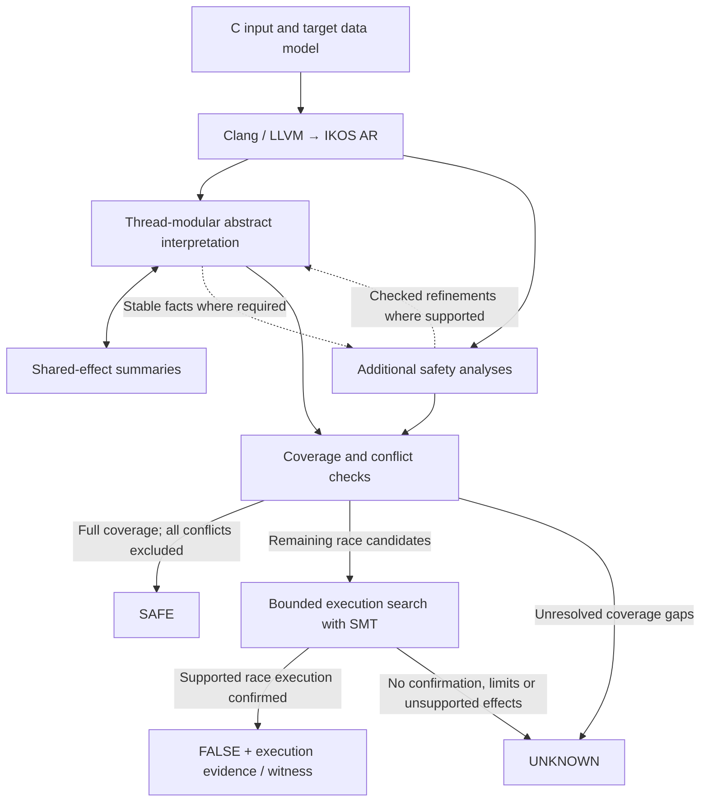

# Concurrent analysis architecture

[Concurrent analysis documentation](../../CONCURRENCY.md)

This page describes the current source checkout. Published archives retain the
source revision and capabilities recorded in their `BUILD-INFO.json`; updating
the repository does not update an archive.

## Architecture and code navigation

The frontend translates C through LLVM into AR, IKOS's intermediate representation.
The abstract interpreter analyzes each thread using a shared summary of possible
cross-thread effects. Shared-summary changes trigger thread reanalysis.
Additional safety analyses check specific memory and
synchronization patterns. The race checker uses their results only when their
individual proof conditions hold.

**BMC confirms races; it does not prove unbounded safety.** Failure to find a
race, including bounded UNSAT, leaves the case inconclusive. The additional
safety analyses have separate contracts; they are not all numerical abstract domains.

For example, two accesses protected by the same proven mutex may be excluded
before BMC. Two unresolved accesses instead become search candidates; an
abstract warning alone cannot establish a real race.

| Component | Source |
| --- | --- |
| Concurrent worklist and shared-summary iteration | [analyzer/src/analysis/value/thread_modular.cpp](../../../analyzer/src/analysis/value/thread_modular.cpp) |
| Concurrent library transfers | [analyzer/include/ikos/analyzer/analysis/execution_engine/concurrent_semantics.hpp](../../../analyzer/include/ikos/analyzer/analysis/execution_engine/concurrent_semantics.hpp) |
| Shared environment and lock/thread facts | [core/include/ikos/core/domain/concurrent_global_env.hpp](../../../core/include/ikos/core/domain/concurrent_global_env.hpp), `lockset/lockset_domain.hpp` |
| Access collection, finalization and proof consumers | [data_race.cpp](../../../analyzer/src/checker/data_race.cpp) |
| Fixed-order pair adapters and candidate scan | [data_race_pairs.cpp](../../../analyzer/src/checker/data_race_pairs.cpp) |
| Bounded candidate search | [data_race_search.cpp](../../../analyzer/src/checker/data_race_search.cpp) |
| Mechanism identities and distinct permissions | [race_rules.hpp](../../../analyzer/include/ikos/analyzer/checker/race_rules.hpp) |
| Bounded exploration, values, addresses, synchronization and evidence | `analyzer/include/ikos/analyzer/analysis/bmc/` |
| Independent exported AR execution checks | [scripts/validate_bmc_execution.py](../../../scripts/validate_bmc_execution.py) |
| Source witness export and BenchExec interface | `svcomp_witness.py`, [benchexec/tools/ikos-conc.py](../../../benchexec/tools/ikos-conc.py) |

Thread completion facts cover actual instance IDs, including every registered
static instance of a shared worker entry. An instance missing from one thread's
creation history may already be running under another creator. Such absence is
never treated as a completed join. Creation-before-access and inactive-child
exclusions use their own creator and lifetime conditions.
`pthread_self()` is bound to the actual thread entry, including calls through
helpers. A join that may target the caller cannot establish completion, remove
a live instance, or import the target's completion summary. Same-entry dynamic
instances remain conservative when their identities cannot be distinguished.

Original IKOS numerical analyses and general parameters are described in
[analyzer/README.md](../../../analyzer/README.md). Keep property queries separate from
reusable thread and memory semantics.

Range premises shared by the interpreter and safety analyses use
`analysis/all_access_facts.hpp`. Each analysis run collects observations for
the exact statement and object in its query inventory. All reachable contexts
must satisfy the predicate; a missing or failed observation cannot prove it.
The driver publishes the facts after replay and shared-summary flushing have
finished without further changes. A later observation invalidates publication.
Independent preflight facts still require the existing effect-coverage checks
before they can refine a fresh interpreter run. A range fact alone grants no
thread completion, synchronization, or permission to discard a shared write.
The final checking replay rechecks each function's MUST-join summary against
the converged result. A changed summary leaves an unresolved convergence warning.
New provenance used to widen indirect callees also invalidates convergence;
repeated observations do not.
The independent range preflight treats every application-memory load as a
fresh arbitrary value and does not execute application-memory stores. It also
uses no external pointer refinement. Thus a missing write cannot preserve an old
shared guard or prune a control-dependent index branch. SSA arithmetic, explicit
constraints, helper calls and loop fixpoints still establish all-access bounds;
aggregate loads forget their complete contents. Only the resulting stable bounds
cross into the fresh ordinary analysis. They do not discharge that analysis's
unknown-write warnings or prove pointer values, synchronization, or safety by
themselves. Unsupported calls, thread coverage gaps or missing/failed observations
still block certificates.

## Final checker lifecycle

The race checker collects accesses during the final checking replay. The driver
then calls `Checker::finalize()` explicitly, once normal analysis has completed.
For the thread-modular driver the order is:

1. Complete the checking replay and analyze global destructors.
2. Flush shared summaries; retain a warning if convergence has changed.
3. Publish the three all-access range inventories only when stable.
4. Store function records, mark normal race-analysis completion, then finalize the property checkers.

`DataRaceChecker::finalize()` performs coverage checking, access preparation,
pair exclusion, bounded search and reporting. Its destructor only releases
resources. Collection after finalization and repeated finalization are rejected.
An exception during finalization propagates to the analyzer's normal error path;
unwinding does not attempt to prove or emit additional results. The other four
checker-owning drivers also finalize at normal completion. Unsupported
thread-modular engine combinations are rejected before analysis.

## Final race-checking stages

The explicit finalizer calls these stages in order:

| Stage | Method | Responsibility |
| --- | --- | --- |
| Coverage | `check_effect_coverage`, `refresh_coverage` | Retain registered entries/effects/completion/stability obligations and exact safety-only replacements. Block determinate verdicts before scanning when unresolved. |
| Access preparation | `prepare_access_regions` | Invalidate ambiguous region labels or backfill labels already established during collection. |
| Candidate scan | `collect_race_pairs` | Represent nonunique worker writes, compute completion facts, apply exclusions and retain unresolved pairs. Register surviving mixed atomic boundaries and recheck coverage. |
| Search | `search_race_candidates` | With checked coverage and no safety-only replacement, group unresolved pairs and schedule applicable execution profiles under the file deadline; see the [search sequence](../reference/bounded-execution.md#search-sequence-and-shared-budget). |
| Reporting | `report_race_group`, `publish_result` | Buffer group reports; recheck coverage before inserting confirmation/evidence. Write the final property metadata once. |

`ReadonlyHeapReads` and `BucketListOwnership` are constructed before access
preparation, as required by their existing contracts. The other pair-proof
modules are constructed after nonunique write duplication and completion-fact
preparation. `BinaryTokenOwnership` precedes its `ArenaReservation` and
`OnceInitialization` consumers. Candidate indices refer to the final access
order; search receives read-only candidates and completion-name tables.

The checker-owned `RaceCoverageSummary` starts Pending. Driver completion and
the registered inventory determine Blocked or Checked; Checked is not a general
semantic completeness proof. Required extern constructors/destructors and
skipped entries can register obligations without statement anchors. Disabling
checks records an explicit Pending UNKNOWN. Every allocator retry has a fresh
Context and final result.

Covering an effect with a safety-only certificate does not grant BMC permission
to interpret that effect. The search budget starts only after the candidate
scan and grouping. The stages preserve the existing short-circuit order and
report anchors; moving a stage does not extend a module's supported semantics.

## Fact ownership and composition

`Context` owns each run's shared MAY summaries, MUST range observations and
immutable source certificates. These are distinct kinds of evidence. Shared
MAY effects grow or lose precision conservatively; all-access MUST observations
combine by conjunction and can only be consumed after their publication contract
holds.

The three preflight outputs have const readers: `mutex_effect_certificates()`,
`subarray_bounds_certificates()` and `native_handle_effect_certificates()`.
Only the thread-modular driver publishes them after the independent preflight's
complete coverage and range checks. The ordinary analysis remains a fresh run;
it does not inherit preflight memory or synchronization state.

Whole-source runtime stdio, pthread initialization and semaphore certificates
also expose const readers. Their existing configuration functions are the only
writers. Each is bound to this `Context` and AR bundle; consumers retain their
actual-call, object, byte, context and coverage checks. A const handle prevents
replacement by another consumer; it does not prove the original algorithm.

Pair proofs are consumed immediately for final access indices while the checker
is finalizing. Coverage proofs instead identify an actual raw effect obligation.
BMC receives candidates only after the strict coverage gate and checks its own execution support;
no range, pair or coverage proof grants it general execution permission.

## Native thread-argument windows

With explicit VarPack Polka and guard partitioning, the thread driver can prepare
one closed creation family before constructing the checkers. Native abstract
transfers propagate the relation between each entry argument and its shadow;
the final consumer combines stable relative access windows with the proven
creation stride. Both endpoints must refer to the same certified family and
object. Missing observations, incomplete analysis or a dirty shared summary
withdraw the proof.

The default interval domain also supports a narrower source-certified affine
family without adding shadows or changing numerical transfers. The actual LLVM
induction and matching AR loop must create each worker from the same stable heap
base at a positive constant stride. Every observed counter range, cast and native
GEP index must preserve that coordinate without wrap; a failed observation
invalidates the family. Each access needs matching LLVM/AR constant displacement
from the real worker parameter and its actual byte width. The final consumer
checks non-overlap in both orientations. Unknown origins, extra activations,
mutable bases, reentry, overlapping windows or an incomplete/dirty analysis
retain the candidate. GNU/Linux ILP32 and LP64 use their own native widths.

The default affine family can also certify one exact main initialization store
before its matching create in each iteration. The actual LLVM/AR store and create
must use the same stable base and index, including structurally identical integer
cast chains. The existing range checks prove that those casts preserve every
observed induction value. Equal-iteration main/worker accesses are ordered by the
actual create; unequal iterations require complete byte separation in both
directions. Only that exact main store can consume
`creation-family-indexed-precreate-v1`. Another main access using the same pointer
cannot borrow the ordering. Stores after create, extra stores, different slots,
reentry and overlapping widths retain the pair. The
`IKOS_RACE_DISABLE_INDEXED_PRECREATE=1` diagnostic switch disables only this final
consumer, preserving the ordinary worker-window rule.

Both paths grant only pair exclusion, not pointer validity, effect coverage,
thread completion or BMC execution permission. The implemented dirty controls exercise withdrawal and
fresh native queries; they do not establish a generic BMC-to-AI refinement loop
or automatic whole-worklist reconvergence. See the [window controls](testing.md#native-thread-argument-windows)
and [pair contract index](../reference/module-contracts.md#pair-rule-groups-and-proof-premises).

## Shared source identities and static queries

The frontend finishes its LLVM/AR transformations before constructing Context.
The per-Context [source inventory](../../../analyzer/include/ikos/analyzer/analysis/source_program_facts.hpp)
then lazily indexes actual source-to-AR identities and caches read-only LLVM
dominance trees. Ordinary analysis, independent preflight and allocator retries
have separate caches even when they share an input bundle. These identities
grant no safety, library-effect or execution permission.

The inventory retains separate duplicate policies for calls/loads/stores and
for those statements plus allocations. It also records whether every selected
statement has a source instruction in its actual function, and distinguishes
defined functions from declarations. `ThreadLifecycle` reuses these indices and
requires both unique and complete mappings while charging its original statement
work bound. Missing frontend identities stay missing. Consumers still enforce
their own complete-effect inventory, function ownership, ABI and library contracts.
Dominance queries preserve instruction order within a block; each consumer retains
its own conservative reachability checks.

The once transfer caches only a closed source/effect query's selected callbacks,
keyed by the actual AR call. The original 16384-step logical bound still counts
every AR body statement, including statements absent from the index; a limited
first scan stops at that bound. A cached empty result remains unsealed, and a
caller's direct-callback fallback cannot alter it. Every dynamic transfer still
registers callbacks, MAY writers, dirty changes and joined locksets.

Barrier capacity facts remain owned by the barrier producer, reading the same
transformed LLVM module bound to AR, without another frontend pass. Its bounded
integer sets, checked descending-loop interval and closed private-field loads
are not general LLVM optimization or a replacement for ordinary interpretation.
The existing all-access facts publish mutex-byte, subarray and handle bounds;
they do not publish arbitrary barrier capacities. Barrier effects are configured
before ordinary transfer, so importing the result of that same transfer to
justify its own barrier effect would be circular. Source identities, dominance
and the identical ordinary-attribute predicate are shared; value facts and
library proof conditions retain their separate owners.
