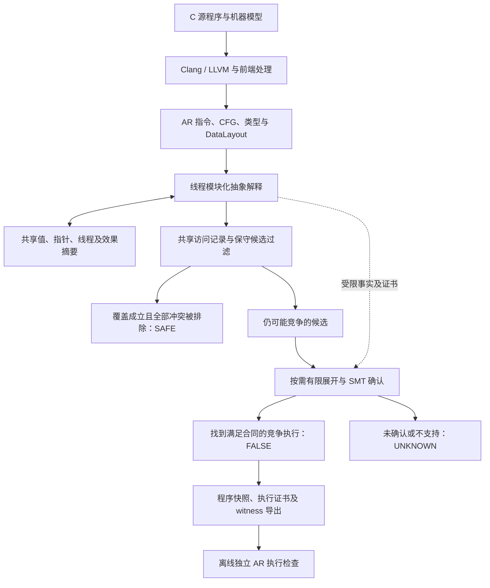

# IKOS-ConC：整体架构与代码阅读路线

本文解释现有工程骨架。详细 SAFE 语义由 [AI 手册](ikos-ai-complete.md)维护，
详细 FALSE 语义由 [BMC 手册](ikos-bmc-complete.md)维护；
版本、任务集合和最新实验见 [阅读入口](README.md#current)。

<a id="pipeline"></a>
## 1. 从 C 到分析结果



这是已有主流程；箭头不表示任意 C/POSIX 语义已被完整建模。
离线检查不会自动为正常运行的全部导出证据加上“已验证”标签；
真正 BMC 执行反向精化 AI 的闭环仍是 [研究项](ikos-ai-complete.md#feedback)。

### 三种结果的职责

- SAFE 依赖覆盖全部相关执行、访问效果和保守过滤；没有候选只有在覆盖前提成立时才有意义。
- FALSE 依赖具体有限竞争执行：控制、线程实例、值、对象与同步均须成立；
  SMT SAT 只有在编码保持这些义务时才可用于确认。
- UNKNOWN 表示未能证明或确认；失败/超时另行统计。
  有界 UNSAT、截断和不支持不能产生 SAFE。

比赛模式把抽象 race warning demote 为 UNKNOWN，再尝试由 BMC 确认 FALSE。
非 demote 的旧 may-warning 输出不能当成经执行验证的反例。

## 2. 原生 IKOS 与并发扩展

原生 IKOS 提供 LLVM→AR 导入、数值/指针/内存抽象域、
过程间执行与局部不动点、checker、数据库及报告基础设施。
并发扩展沿用这些能力，增加线程与同步状态、跨线程效果及性质判断。
保留原生代码不等于证明扩展对原生分析有严格能力支配。

| 所属层 | 当前职责 | 代码入口 |
| --- | --- | --- |
| 前端与布局 | 保留相关访问/原子，导入调用、类型、机器位宽和内存长度 | `frontend/llvm/`、`ar/`、`DataLayout` |
| 执行引擎 | 普通 AR 转移，pthread dispatch、实际参数/上下文、未知效果回退 | `numerical.hpp`、`concurrent_semantics.hpp`、`concurrent_inliner.hpp` |
| 抽象域 | 局部数值/内存与 MAY/MUST 线程、锁事实 | `AbstractDomain`、`LocksetDomain` |
| 共享环境 | 汇总可能写、指针来源、逃逸和线程生命周期事实 | `ConcurrentGlobalEnv` |
| 分析驱动 | 局部 CFG 不动点、共享摘要外层重算、最终检查稳定性 | `ThreadModularAnalysis` |
| 性质 checker | 记录访问，按充分条件排除不可能竞争的对 | `DataRaceChecker`、`AccessRecord` |
| BMC 与证据 | 真实前缀、值源、地址、同步、目标冲突和结构化结果 | `analysis/bmc/`、`validate_bmc_execution.py` |
| 对外报告 | 三值判定、source/witness 映射和 BenchExec 接口 | `analyzer.py`、`report.py`、`svcomp_witness.py` |

线程模块化在抽象环境下分析各线程，不枚举全部交错。
覆盖义务由环境干扰和耦合收敛承担；sound privatization 可以在这种框架下定义，
但具体精化必须证明保护、初始化与全部外部写的覆盖。

## 3. 一次共享访问怎样流动

以下示例省略错误分支，采用有效、成功的 pthread 合同。

```c
int x;
pthread_mutex_t m = PTHREAD_MUTEX_INITIALIZER;

void *work(void *unused) {
  pthread_mutex_lock(&m);
  x = 1;
  pthread_mutex_unlock(&m);
  return 0;
}

int main(void) {
  pthread_t t;
  pthread_create(&t, 0, work, 0);
  pthread_mutex_lock(&m);
  x = 2;
  pthread_mutex_unlock(&m);
  pthread_join(t, 0);
  return 0;
}
```

1. 前端把全局初值、函数、调用、store 和 CFG 导入 AR。
   `DataLayout` 决定对象与访问宽度；不能凭 C 字段名推断地址。
2. create 发现 `work`，绑定实际参数和句柄输出，更新 MAY 创建事实。
   若入口不能覆盖，记录分析不完整，不能因缺少 worker 访问而报 SAFE。
3. store 更新本线程局部内存，同时贡献共享可能写；不同线程的写不能在摘要中相互覆盖。
4. 访问记录包含线程/调用背景、可能对象、offset、width、读写种类和持锁事实。
   摘要对象是否代表同一具体对象需要额外条件。
5. checker 证明两次写持有同一具体互斥锁，排除该对；
   支持效果覆盖且其余候选均被排除时得到 SAFE。
6. 若删掉 worker 的 lock/unlock，共同锁前提失效，候选保留。
   比赛配置先为 UNKNOWN；BMC 搜索实际 create 与两次写的有限执行。
7. 若 BMC 建立合法地址、定义值和无目标 HB，确认 FALSE；
   独立解释器可重走该 AR 执行。预算不足或未建模仍为 UNKNOWN。

join 只排序真实目标完成与 join 后行为，不使之前未加锁的写自动安全。
本例展示分工，不替代失败 API、死锁或弱内存模型。

## 4. 摘要为何需要反复分析

函数内 CFG 有局部 join/widening，线程间有外层环境不动点。
新可能写会改变其他线程的 load、guard、地址与访问覆盖。
共享值范围、pointer offset/TOP、创建目标或 MUST 摘要发生语义变化，
必须触发依赖重算；只看容器长度可能漏掉变化。

最终 checker 使用稳定结果；检查阶段若又扩张摘要，旧访问/SAFE 证书可能失效。
详见 [耦合收敛](ikos-ai-complete.md#fixpoint)。

顶层乘积域的第二分量承载锁集，第一分量承载数据/异常状态。
MUST 持锁/完成合流取交，MAY 创建/存活合流取并；
各集合的 TOP/BOTTOM 与非并发判断见 AI 手册。
跨线程环境由分析上下文持有。

<a id="contracts"></a>
## 5. IKOS 与 BMC 的接口边界

IKOS 提供 may 对象/地址、width、候选、实际上下文，以及受限的
no-wrap 和至多一次执行证书。BMC 消费前必须满足各自合同。
抽象初始化区间不是实际 store；一个静态创建点不代表唯一动态实例。

已有协同证据：

- 跨 helper 锁/数据证明先排除互斥候选，两个 funloop 的无效 UNSAT 查询由
  424/430 次降到 10 次后找到竞争，见
  [证据](artifacts/ai-precision-2026-10-11/helper-context/summary.json)。
- AI 单生命周期证明帮助 BMC 绑定 helper 发布指针；
  关闭事实组为 UNKNOWN，启用后确认执行，见
  [消融](artifacts/ai-precision-2026-10-11/publication/summary.json)。

第一项是候选减少，第二项是能力恢复；均不自动证明整体快于 Dartagnan。
事实组开关还关闭其他数值 facts，不能称仅隔离生命周期一个因素。

### 5.1 实施前必须区分的四种事实

**2026-10-13 设计审查：以下是后续接口合同，不是已经实现的新证书系统。**
当前生产者是 `data_race.cpp`，载体为 `bmc/facts.hpp::CandidateFacts`，
消费者是 `encode.hpp` / `unroll.hpp`。按用途分离义务，比统一成一个“可信 AI 值”更重要：

| 用途 | 当前例子 | 成立条件与失败处理 |
| --- | --- | --- |
| 搜索提示 | 候选顺序、字面循环界提示 | 不声明程序事实；预算有限时可能改变发现率，保留旧成功搜索顺序并配对验收 |
| 额外约束 | 候选 offset 上下界 | 若原执行公式为 E，添加 F 得到 E∧F 不会凭空产生 E 的模型；若要保持全部原模型，可证明 E⇒F，预算内发现率和开销另须配对实测。事实缺失则不加约束，不能用共享读的陈旧区间代替真实来源 |
| 省略检查或许可解释的证书 | unused no-wrap、helper 单次执行/发布 | 删除定义性条件 D 后必须另证 E₀⇒D；at-most-once 也不能单独证明 fresh、发布顺序和存活。不可证时执行原检查，或保持 UNSUPPORTED |
| SAFE 排除证明 | 共同锁、非并发、may 对象/字节范围不交 | 必须覆盖该访问摘要代表的全部具体实例；不是选一个有利调度。失败保留候选，不能借 BMC 有界 UNSAT 删除 |

这个区别解释了两类风险：错误的附加范围通常损失 BMC 确认能力；错误的检查省略证书可能
直接制造假执行。同一个错误范围若用于上游 SAFE 删除，则还可能漏报。上述推理以原执行
公式保持性成立为前提，不是对当前全部编码的自动认证。

未来每个跨边界事实至少说明 **对象/语句与调用作用域、位宽和语义配置、生产前提、
消费方式、依赖及失效条件**。当前单次查询内事实可借现有不可变 AR/访问记录传递；
只有引入跨轮缓存或反馈时才需要稳定 ID、摘要代次和重查，暂不建立通用 proof framework。
AR 指针只作进程内索引，不能成为持久证据身份。

### 5.2 三条可审查的证明链

1. **SAFE**：局部转移及环境摘要过近似 → 全部线程/访问覆盖 → 每个被排除的冲突有全称充分条件。
   `ThreadModularAnalysis` 已有 dirty 重算和最终摘要变化→UNKNOWN 防护；
   尚需逐类审查共享摘要 setter 是否完整触发失效，不能把“达到迭代停止”当独立归纳认证。
2. **FALSE**：所选真实创建/路径 → 值、地址、同步与库合同 → SAT 模型能提升为有限竞争执行。
   省略线程的根据只能是这个有限前缀中可以不调度；join、等待或供值所必需的线程须纳入。
3. **反馈后的 SAFE**：BMC 只提出精度选择 → 新 AI 从初态重算全部干扰不动点 → 再按第一条验收。
   另一条可研究路线是完整 init/step/environment 归纳检查；现有有界查询不具备该覆盖。

一个容易混淆的边界是：共同持锁可以排除某对访问发生竞争，却不能删除这些临界区之间的
写入干扰或 read-from 来源。Goblint digest 论文作者扩展版 §5.1 Remark 3 明确区分这两种关系；
锁/历史兼容性迁移需要遵守它，见 [AI 理论出处](ikos-ai-complete.md#references)。

辅助执行补全沿第二条证明链实现：AI 的对象/范围、历史和效果信息先用于搜索相关
生产者，BMC 再解释实际路径。静态 MUST joined 可服务全称 SAFE 排除，却不提供一个
孩子的可执行终止路径；抽象返回/干扰值也不能直接服务 FALSE。若尝试省略必要线程
或事件，需另证值源、同步、完成及生命周期的执行保持，不只证明目标地址不相交。
新 trace 的身份绑定实际 creator occurrence，锁和 join 的 HB 在全 trace 集计算。
受限核查、工程入口和论文假设分别见 [BMC 辅助执行](ikos-bmc-complete.md#auxiliary-feasibility)
与 [论文构想](ikos-ai-complete.md#auxiliary-research)；不是现有 M6 反馈实现。

独立 AR 检查器重新执行 CFG、字节内存和 vector clock，但程序快照仍由分析器导出。
`sweep_bmc_execution.py::validate_report` 从同一报告提取快照后计算 hash，不能由此证明
C→AR 转换正确；CLI 核对源 hash 也只绑定文件身份。后续证据应同时固定源码/YAML、
编译选项、bitcode/AR、API/内存合同和所选执行，另用源 witness 校准跨语言映射。
这些身份绑定不消除前端/快照/API 的可信边界，也不把离线检查变成在线判定门。

本轮审查没有建立新的分析器误判反例。已确认的问题是消融说明和部分旧注释落后于实现；
其余是尚未闭合的证明义务。具体源码锚点和正反测试设计见
[设计依据](artifacts/strategic-design-2026-10-13/review.json)。

## 6. 按符号找代码

路径相对项目根目录；使用符号搜索，不依赖旧行号。

| 想追踪什么 | 文件与符号 |
| --- | --- |
| 分析启用 | `analyzer/src/ikos_analyzer.cpp`、`analysis/option.hpp` |
| 局部/线程驱动 | `analyzer/src/analysis/value/thread_modular.cpp` |
| 共享环境 | `core/include/ikos/core/domain/concurrent_global_env.hpp`：dirty、写/pointer/join summaries |
| 并发格 | `core/include/ikos/core/domain/lockset/lockset_domain.hpp`：join、MUST locks、MAY live/spawn |
| 调用/线程转移 | `analyzer/include/ikos/analyzer/analysis/execution_engine/`：`exec_pthread_*`、`exec_unknown_extern_call` |
| 访问与过滤 | `analyzer/include/ikos/analyzer/checker/data_race.hpp`：`AccessRecord`；`analyzer/src/checker/data_race.cpp` |
| AI facts | `analyzer/include/ikos/analyzer/analysis/bmc/facts.hpp`：`CandidateFacts` |
| 展开与编码 | 同目录 `unroll.hpp`、`encode.hpp`、`function_values.hpp` |
| 结果与执行证书 | 同目录 `result.hpp`、`replay.hpp`；`scripts/validate_bmc_execution.py` |
| 上游对照 | `/home/ruan/ikos-original`，核实 revision 后比较具体模块 |

## 7. 当前框架的完成范围

已有 AI/候选/BMC/证据链路，以及受限的保护相关 release 端值和稳定指针发布机制。
开放项包括这些机制的一般化、一般动态实例与 heap/lifetime、完整 POSIX 失败和 C11 弱内存、
官方源级 witness 验收、有效的 BMC→AI 归纳精化。
有些缺口是 API 覆盖，有些需要改进抽象域、摘要及失效接口。

后续沿所有权层增量完善。死锁/可达性可复用线程与内存基础，
但必须新增各自性质、覆盖合同、报告与验证。
